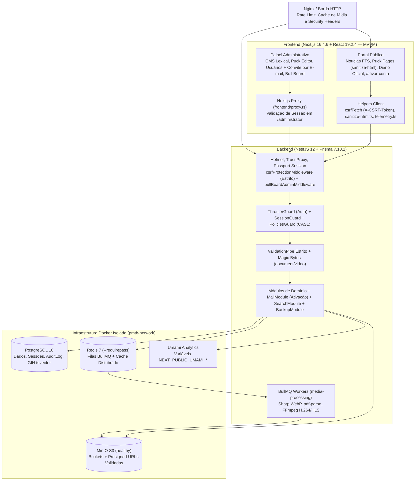

# Relatório Completo de Análise do Projeto — Auditoria Pós-TO-DO 3.0

**Data da Análise:** 18 de novembro de 2026  
**Escopo:** Revisão completa de Arquitetura, Stack e Dependências (`npm audit --omit=dev` / `pnpm audit --prod`), Auditoria de Segurança (Vulnerabilidades, Vazamentos e Controle de Acesso) e Levantamento de Débitos Técnicos e Bugs Latentes após a entrega do **TO-DO 3.0** (`fb5942f`).

---

## 1. Resumo Executivo e Evolução da Maturidade

Com a entrega integral dos **TO-DOs 1.0, 2.0 e 3.0**, os principais vetores críticos apontados nas auditorias anteriores foram corrigidos e validados por testes automatizados:

- **Autenticação e Ciclo de Vida de Contas (`TO-DO 3.0 — Nível 1`):**
  - Removidos o Login Gov.br (`govbr-oauth.service.ts`) e o 2FA/TOTP (`totp.service.ts` + `otplib`), mantendo o 2FA planejado apenas para pós-lançamento do site teste.
  - Implantado o sistema de **Ativação de Conta por Link Único com Definição de Senha** ([mail.service.ts](file:///d:/Site%20-%20Prefeitura/site-test/backend/src/common/mail/mail.service.ts), [user.service.ts](file:///d:/Site%20-%20Prefeitura/site-test/backend/src/user/user.service.ts), [auth.service.ts](file:///d:/Site%20-%20Prefeitura/site-test/backend/src/auth/auth.service.ts), [ativar-conta/page.tsx](file:///d:/Site%20-%20Prefeitura/site-test/frontend/app/(pages)/(public)/ativar-conta/page.tsx)), com prazo de expiração (24h padrão), uso único (`activationTokenMaxUses = 1` + atualização atômica), bloqueio de login/sessão para contas inativas (`active: false`) e reenvio de link por Administrador (`POST /user/:id/resend-activation`).
- **CSRF Estrito Full-Stack (`TO-DO 3.0 — Nível 2`):**
  - Criado `csrfFetch` com obtenção automática de token em [csrf.ts](file:///d:/Site%20-%20Prefeitura/site-test/frontend/lib/csrf.ts) e aplicado em todos os 14 serviços de mutação do frontend.
  - Removido o modo permissivo de [csrf.middleware.ts](file:///d:/Site%20-%20Prefeitura/site-test/backend/src/common/middleware/csrf.middleware.ts), bloqueando mutações sem cookie e header `X-CSRF-Token` com `403 Forbidden`.
- **Correções P0/P1 da Auditoria Anterior (`TO-DO 3.0 — Nível 3`):**
  - Sanitização anti-XSS nos blocos Puck `Texto` e `Embed` e em `DynamicIcon` via [sanitize-html.ts](file:///d:/Site%20-%20Prefeitura/site-test/frontend/lib/sanitize-html.ts).
  - Correção de *Route Shadowing* em [media.controller.ts](file:///d:/Site%20-%20Prefeitura/site-test/backend/src/media/media.controller.ts) e [story.controller.ts](file:///d:/Site%20-%20Prefeitura/site-test/backend/src/story/story.controller.ts).
  - Correção da divergência `bannerId` → `galleryId` em [gallery-media.service.ts](file:///d:/Site%20-%20Prefeitura/site-test/backend/src/gallery-media/gallery-media.service.ts).
  - Validação contra *path traversal* (`..`) e checagem `status === 'ready'` em `GET /media/presigned/*path`; remoção de `email: true` em [galleries.service.ts](file:///d:/Site%20-%20Prefeitura/site-test/backend/src/galleries/galleries.service.ts); preservação de `userId` original em [services.service.ts](file:///d:/Site%20-%20Prefeitura/site-test/backend/src/service/services.service.ts); limites `page >= 1` e `limit <= 100` em `ServicesService.findAllPublic` e `StoryController.findAllStories`.
- **Linha de Base de Qualidade e Auditoria Atual:**
  - **Testes Vitest:** **68/68** aprovados no backend (12 arquivos) e **7/7** no frontend (`test/portal.test.ts`).
  - **TypeScript & ESLint:** `tsc --noEmit` (`0` erros) e `lint-staged` passando com `0` erros.
  - **Dependências:** **`0` vulnerabilidades de produção no backend** (`npm --prefix backend audit --omit=dev`); **12 alertas transitivos no frontend** (`0` críticas, 7 altas, 4 moderadas, 1 baixa via `pnpm --dir frontend audit --prod`).
  - **Novos Achados desta Auditoria:** Persistem **5 pontos de atenção de segurança/controle de acesso** (LGPD em detalhe público do Diário Oficial, rotas públicas sem filtro de status/vigência, lacunas de RBAC/ABAC no CASL e ausência de `ThrottlerGuard` global) e **5 débitos técnicos / bugs latentes** (incluindo divergência singular/plural `/story/item/:id` vs `/story/items/:id` no frontend).

---

## 2. Análise de Arquitetura Atualizada

---

## 3. Análise de Stack e Dependências (Cruzada com Segurança)

### 3.1. Backend (`npm --prefix backend audit --omit=dev` e `npm audit`)
- **Produção (`--omit=dev`):** **`0` vulnerabilidades encontradas** após remoção de `otplib` e atualizações prévias de `sharp` (`^0.35.5`) e `@prisma/client` (`^7.10.1`).
- **Desenvolvimento (`devDependencies`):** **23 vulnerabilidades** (2 moderadas, 21 altas) exclusivamente em ferramentas de build e teste (`vitest`, `@nestjs/cli`, `typescript-eslint`, `ts-loader`, `unplugin-swc`), sem impacto na imagem de produção.

### 3.2. Frontend (`pnpm --dir frontend audit --prod`) — **12 vulnerabilidades transitivas (`0` críticas, 7 altas, 4 moderadas, 1 baixa)**
Todas decorrem de dependências transitivas de **`@puckeditor/core`** e **`next`**:

| Origem Direta | Subdependência Vulnerável | Severidade | Advisory / Impacto | Mitigação Recomendada |
| :--- | :--- | :--- | :--- | :--- |
| **`@puckeditor/core`** | `happy-dom` (incl. via `@tiptap/html` interno ao Puck) | 🟠 **High (2) / Mod (1)** | `GHSA-834v-8h66-3h79`, `GHSA-c8p4-j97h-3vg8`, `GHSA-5fpq-26gf-qwcr` | Adicionar `"happy-dom": ">=21.0.4"` em `pnpm.overrides`. |
| **`@puckeditor/core`** | `@tiptap/core` e `prosemirror-view` | 🟠 **High (2) / Mod (1)** | `GHSA-c8x8-7fp4-3x9w`, `GHSA-j95f-988m-3j2f`, `GHSA-cp6q-959q-f8rh` | Adicionar `"@tiptap/core": ">=3.30.5"` e `"prosemirror-view": ">=1.42.3"` em `pnpm.overrides`. |
| **`@puckeditor/core`** | `uuid` | 🟡 **Moderate (1)** | `GHSA-w5hq-g745-h8pq` | Adicionar `"uuid": ">=11.1.1"` em `pnpm.overrides`. |
| **`next`** | `browserslist`, `source-map-js`, `@babel/core` | 🟠 **High (3) / Mod (1) / Low (1)** | `GHSA-c83g-rgw3-j3cx`, `GHSA-73wf-gq98-2v4g`, `GHSA-68fv-2mgg-jv7q`, `GHSA-4x5r-pxfx-6jf8` | Aplicar `"browserslist": ">=4.28.7"` e `"source-map-js": ">=1.2.2"` em `pnpm.overrides` ou aguardar patch do Next.js. |

---

## 4. Vulnerabilidades, Vazamentos e Brechas Residuais Identificadas

### 🟠 Severidade Média

#### 4.1. Vazamento de E-mail e Papel de Servidores em `GET /official-gazette/:id` (LGPD)
- **Localização:** [official-gazette.controller.ts](file:///d:/Site%20-%20Prefeitura/site-test/backend/src/official-gazette/official-gazette.controller.ts#L57-L63) e [official-gazette.service.ts](file:///d:/Site%20-%20Prefeitura/site-test/backend/src/official-gazette/official-gazette.service.ts#L231-L263).
- **Descrição:** Embora a listagem pública `GET /official-gazette` (`findAllPublic`) omita corretamente dados de usuários, a rota pública de detalhe `GET /official-gazette/:id` chama `findOne(id)`, que inclui `createdBy` e `updatedBy` selecionando `email: true` e `role: true`.
- **Impacto:** Exposição pública de e-mails funcionais e níveis de privilégio (`ADMIN` / `PUBLISHER`) de servidores municipais.
- **Correção Recomendada:** Separar `findOnePublic(id)` (sem `createdBy`/`updatedBy` ou apenas com `{ name: true }`) de `GET /official-gazette/admin/:id` protegido por `SessionGuard + PoliciesGuard`.

#### 4.2. Exposição Pública de Rascunhos, Inativos e Itens Expirados em Módulos Secundários
- **Localização:**
  - [popups.controller.ts](file:///d:/Site%20-%20Prefeitura/site-test/backend/src/popups/popups.controller.ts#L24-L32) / [popups.service.ts](file:///d:/Site%20-%20Prefeitura/site-test/backend/src/popups/popups.service.ts#L62-L87)
  - [galleries.controller.ts](file:///d:/Site%20-%20Prefeitura/site-test/backend/src/galleries/galleries.controller.ts#L24-L32) / [galleries.service.ts](file:///d:/Site%20-%20Prefeitura/site-test/backend/src/galleries/galleries.service.ts#L34-L59)
  - [story.controller.ts](file:///d:/Site%20-%20Prefeitura/site-test/backend/src/story/story.controller.ts#L73-L81) / [story.service.ts](file:///d:/Site%20-%20Prefeitura/site-test/backend/src/story/story.service.ts#L204-L239)
  - [organizations.controller.ts](file:///d:/Site%20-%20Prefeitura/site-test/backend/src/organizations/organizations.controller.ts#L24-L32) / [organizations.service.ts](file:///d:/Site%20-%20Prefeitura/site-test/backend/src/organizations/organizations.service.ts#L24-L75)
- **Descrição:**
  - `GET /popups` e `GET /popups/:id` retornam popups inativos (`active: false`), em rascunho, arquivados ou fora da janela `publicationDate`/`expirationDate`.
  - `GET /galleries` e `GET /galleries/:id` retornam galerias com `active: false`.
  - `GET /story/items` e `GET /story/items/:id` retornam slides sem filtrar `publishedDate`/`expirationDate` (diferente de `GET /story/:storyId/items`), além de `GET /story/:id` aceitar `items` apenas quando ambos `publishedDate` e `expirationDate` estão preenchidos.
  - `GET /organizations?includeInactive=true` e `GET /organizations/tree?includeInactive=all` permitem a visitantes anônimos consultar órgãos/secretarias desativados.
- **Correção Recomendada:** Filtrar `active: true`, `status: 'publicado'` e janela de publicação/expiração nas rotas públicas e criar endpoints `/admin` autenticados para o painel.

#### 4.3. Lacunas de RBAC/CASL (`MANAGER`, Rotas Admin sem `@CheckPolicies` e Mutabilidade de Autoria em `Popups`)
- **Localização:** [casl-ability.factory.ts](file:///d:/Site%20-%20Prefeitura/site-test/backend/src/casl/casl-ability.factory.ts#L101-L130), [analytics.controller.ts](file:///d:/Site%20-%20Prefeitura/site-test/backend/src/analytics/analytics.controller.ts), [pages.controller.ts](file:///d:/Site%20-%20Prefeitura/site-test/backend/src/pages/pages.controller.ts#L29-L51), [media.controller.ts](file:///d:/Site%20-%20Prefeitura/site-test/backend/src/media/media.controller.ts#L129-L300) e [popups.service.ts](file:///d:/Site%20-%20Prefeitura/site-test/backend/src/popups/popups.service.ts#L105-L126).
- **Descrição:**
  - O enum `UserRole` inclui `MANAGER` (exposto no `UsersModal`), mas `CaslAbilityFactory` só define regras para `ADMIN`, `PUBLISHER` e `USER`, deixando usuários `MANAGER` praticamente sem permissões administrativas no backend.
  - `AnalyticsController` (todas as rotas), `PagesController` (`GET /pages`, `GET /pages/:id`) e `MediaController` (`GET /media`, `GET /media/list/*`, `GET /media/images`, `documents`, `videos`, `:id`) usam `SessionGuard` / `PoliciesGuard` sem `@CheckPolicies(...)`, permitindo que qualquer usuário autenticado de perfil `USER` leia analytics globais, mídias e páginas não publicadas de outras secretarias.
  - `PopupsService.update` ainda aceita `userId` no payload e sobrescreve o criador original do popup (`if (userId !== undefined) data.userId = userId;`), enquanto [PagesService.create](file:///d:/Site%20-%20Prefeitura/site-test/backend/src/pages/pages.service.ts#L19-L21) ainda admite fallback `createPageDto.userId` caso `userId` de sessão falhe.
- **Correção Recomendada:** Formalizar permissões do `UserRole.MANAGER` em `CaslAbilityFactory`, adicionar `@CheckPolicies` nas rotas de leitura administrativa de `Analytics`, `Pages` e `Media`, e impedir sobrescrita de `userId` em `PopupsService.update`.

---

### 🟡 Severidade Baixa

#### 4.4. Rate Limiting Restrito à Autenticação e Paginações sem Teto Máximo
- **Localização:** [app.module.ts](file:///d:/Site%20-%20Prefeitura/site-test/backend/src/app.module.ts#L44), [articles.service.ts](file:///d:/Site%20-%20Prefeitura/site-test/backend/src/articles/articles.service.ts#L161-L243), [media.controller.ts](file:///d:/Site%20-%20Prefeitura/site-test/backend/src/media/media.controller.ts#L129-L149), [media.service.ts](file:///d:/Site%20-%20Prefeitura/site-test/backend/src/media/media.service.ts#L331-L396) e [popups/galleries/services](file:///d:/Site%20-%20Prefeitura/site-test/backend/src/popups/popups.service.ts#L62-L71).
- **Descrição:**
  - `ThrottlerModule` está configurado no `AppModule` (`limit: 60 / 60s`), mas `ThrottlerGuard` não está registrado como `APP_GUARD` global (apenas via `@UseGuards(ThrottlerGuard, ...)` no `AuthController`), deixando endpoints públicos custosos (ex.: `GET /search`, `GET /articles`, `GET /official-gazette`) sem proteção nativa contra flood em nível de aplicação.
  - `ArticlesService.findAll` (público), `PopupsService.findAll`, `GalleriesService.findAll` e `ServicesService.findAll` retornam todos os registros sem `take`, e `MediaController.listFiles` (`GET /media/list/*prefix`) usa `parseInt` sem `Math.max(1, ...)` / `Math.min(100, ...)` — parâmetros inválidos como `?page=abc` produzem `NaN` no Prisma.

#### 4.5. Sanitização HTML via Expressões Regulares vs DOM Parser
- **Localização:** [sanitize-html.ts](file:///d:/Site%20-%20Prefeitura/site-test/frontend/lib/sanitize-html.ts).
- **Descrição:** Embora o utilitário neutralize `<script>`, `<iframe>` em textos, `srcdoc`, `on*=`, `javascript:` / `vbscript:` / `data:text/html` e imponha `sandbox` + `https://` em embeds, sanitizadores baseados em regex possuem menor cobertura diante de HTML malformado extremo do que um parser DOM real (`isomorphic-dompurify`).
- **Recomendação:** Substituir internamente por `isomorphic-dompurify` no ciclo pós-lançamento mantendo a mesma API (`sanitizeHtml`, `sanitizeEmbedHtml`, `sanitizeSvg`).

---

## 5. Débitos Técnicos e Bugs Latentes Identificados

1. **[BUG] Divergência de Rota Singular/Plural em `StoriesService` (`404` no Frontend):**
   - Em [stories.service.ts](file:///d:/Site%20-%20Prefeitura/site-test/frontend/app/service/stories.service.ts#L77-L140), `getStoriesItemById` e `deleteStoriesItem` chamam `${API_URL}/item/${id}` (singular).
   - No backend, [story.controller.ts](file:///d:/Site%20-%20Prefeitura/site-test/backend/src/story/story.controller.ts#L78-L189) define `@Get('items/:id')` e `@Delete('items/:id')` (plural). Enquanto `updateStoriesItem` já usa `/items/${id}`, buscar ou deletar um item individual de destaque pelo frontend falha com `404 Not Found`.

2. **[PÓS-LANÇAMENTO] Reimplantação do 2FA/TOTP Persistido em Banco:**
   - Conforme definido pelo usuário, a autenticação em dois fatores (`totpSecret` criptografado + `twoFactorEnabled` em `User`) permanece adiada para o ciclo pós-lançamento do site teste para perfis `ADMIN` e `PUBLISHER`.

3. **[PÓS-LANÇAMENTO] Sincronização Automática `Media.extractedText` → `OfficialGazette.contentText`:**
   - Em [media.processor.ts](file:///d:/Site%20-%20Prefeitura/site-test/backend/src/media/media.processor.ts#L154-L188), PDFs têm o texto extraído salvo em `Media.extractedText`, e [official-gazette.service.ts](file:///d:/Site%20-%20Prefeitura/site-test/backend/src/official-gazette/official-gazette.service.ts#L108-L124) indexa `OfficialGazette.contentText` via GIN `tsvector`, porém ainda falta vínculo por FK ou *listener* de evento (`media.ready`) para propagar automaticamente o texto extraído do PDF ao registro correspondente do Diário Oficial.

4. **[DÉBITO DE PERFORMANCE] Migração Legada Síncrona em `FoldersService.onModuleInit`:**
   - [folders.service.ts](file:///d:/Site%20-%20Prefeitura/site-test/backend/src/media/folders.service.ts#L20-L87) executa queries e uploads `.keep` sequenciais para S3 a cada inicialização da API se existirem mídias com `folderId: null`, podendo atrasar o boot caso o MinIO esteja lento ou haja grande volume de mídias antigas.

5. **[DÉBITO DE HIGIENE & TIPAGEM]:**
   - `backend/tsconfig.build.tsbuildinfo` e `backend/tsconfig.tsbuildinfo` seguem rastreados no Git e são modificados a cada build/watch (ideal adicioná-los ao `.gitignore` com `git rm --cached`).
   - Typo no nome do arquivo `backend/src/service/dto/update-serviecs.dto.ts`.
   - `GalleryMediaController` protege `GalleryMedia` usando o subject `'Galleries'` em vez do subject dedicado `'GalleryMedia'` (ambos já existem no `CaslAbilityFactory`).
   - No `.github/workflows/ci.yml`, o Playwright E2E atualmente lista specs sem subir o servidor Next.js para execução completa contra o portal.

---

## 6. Roadmap Sugerido (Pós-TO-DO 3.0)

| Prioridade | Ação | Arquivos-Alvo |
| :--- | :--- | :--- |
| **P0 (Bug Real + LGPD)** | Corrigir `/story/item/:id` → `/story/items/:id` no frontend; remover `email` e `role` de `createdBy`/`updatedBy` na rota pública `GET /official-gazette/:id`. | `frontend/app/service/stories.service.ts`, `backend/src/official-gazette/*` |
| **P1 (Visibilidade & RBAC)** | Filtrar ativos/publicados/vigentes em `Popups`, `Galleries`, `Story` e `Organizations` públicas; definir regras de `UserRole.MANAGER`; exigir `@CheckPolicies` em `Analytics`, `Pages` e `Media` admin; tornar `userId` imutável em `PopupsService.update`. | `casl-ability.factory.ts`, `popups.service.ts`, `galleries.service.ts`, `story.service.ts`, `organizations.controller.ts`, `analytics.controller.ts`, `pages.controller.ts`, `media.controller.ts` |
| **P1 (Rate Limit & Paginação)** | Ativar `ThrottlerGuard` como `APP_GUARD` global e validar limites `page >= 1` / `take <= 100` em `MediaController.listFiles`, `ArticlesService.findAll`, `Popups`, `Galleries` e `Services`. | `app.module.ts`, `media.controller.ts`, `media.service.ts`, `articles.service.ts` |
| **P2 (Pós-Lançamento)** | Reimplantar 2FA/TOTP (`ADMIN`/`PUBLISHER`); sincronizar `Media.extractedText` → `OfficialGazette.contentText`; migrar `sanitize-html.ts` para `isomorphic-dompurify`; aplicar `pnpm.overrides` em `frontend/package.json`; desversionar `*.tsbuildinfo`. | `schema.prisma`, `media.processor.ts`, `sanitize-html.ts`, `frontend/package.json`, `.gitignore` |

---

## 7. TO-DO 4.0 — Escopo Consolidado em Execução (Sem 2FA/TOTP)

| Nível | Ação Consolidada |
| :--- | :--- |
| **Nível 1 (LGPD Global)** | Varredura completa em todos os módulos e `ExcludePasswordInterceptor` para eliminar vazamentos de `email`, `role`, `phone`, `username` e `lastLogin` em todas as rotas públicas (`OfficialGazette`, `Pages`, `Articles`, `Popups`, `Galleries`, `Services`, etc.). |
| **Nível 2 (Separação Admin vs Public)** | Separar rotas públicas (filtrando exclusivamente `active: true`, `published: true` / `status: 'publicado'`, `deletedAt: null` e janelas de vigência) de rotas `/admin` protegidas por `SessionGuard + PoliciesGuard + @CheckPolicies` em `OfficialGazette`, `Popups`, `Galleries`, `GalleryMedia`, `Story`, `Organizations`, `Services`, `Menus`, `MenuItem`, `Pages`, `Media` e `Analytics` + corrigir `/story/items/:id` no frontend. |
| **Nível 3 (Role `MANAGER`, `ContentChangeRequest` e Soft Delete)** | Implementada tabela dedicada `content_change_request` (`ContentChangeRequest` com `RequestStatus`/`RequestType`, histórico de rejeições com `rejectionReason`, `proposedData`, `appliedData`, `requestedBy`/`reviewedBy`), módulo centralizado `ApprovalService`/`ApprovalController` (`/approvals`), fila unificada `/administrator/aprovacoes` (`useApprovalQueue`, comparação side-by-side e "Editar e Aprovar"), preservação de rascunho em rejeições e alinhamento de Soft Delete (`Action.SoftDelete`) para `MANAGER` em `Pages`, `Articles`, `Popups`, `Galleries`, `Services`, `Menus`, `MenuItem`, `Organizations` e `Story` (bloqueando gestão de usuários para `MANAGER`). *(2FA/TOTP permanece fora desta rodada, mantido apenas no backlog pós-lançamento).* |
