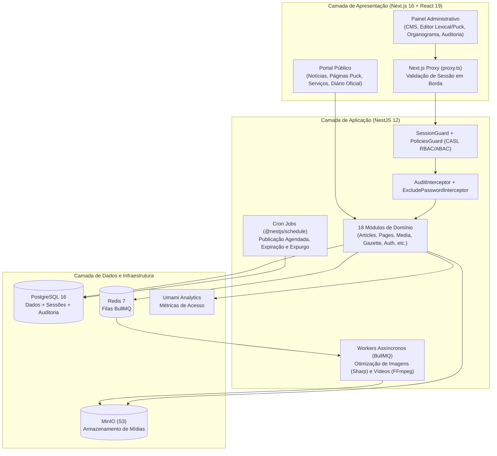

# Relatório Completo de Análise do Projeto — Portal Institucional da Prefeitura

**Data da Análise:** 16 de novembro de 2026  
**Escopo:** Arquitetura de Software, Stack e Dependências, Auditoria de Segurança (Vulnerabilidades e Vazamentos) e Roadmap de Ferramentas Futuras.

---

## 1. Análise de Arquitetura

### 1.1. Visão Geral da Solução
O projeto adota uma arquitetura **Monorepo Multi-serviço** dividida em duas aplicações principais (**Frontend** e **Backend**) orquestradas via Docker Compose junto aos serviços de suporte (PostgreSQL, Redis, MinIO e Umami Analytics).



### 1.2. Arquitetura do Frontend (`/frontend`)
- **Padrão MVVM (Model-View-ViewModel):**
  - **Model (`app/type/`):** Interfaces TypeScript que definem os contratos de domínio (`IArticle`, `IPage`, `IMedia`, `IOrganization`, `IUser`, etc.).
  - **Service (`app/service/`):** Classes estáticas responsáveis exclusivamente pela comunicação HTTP (`fetch` com `credentials: "include"`).
  - **ViewModel (`app/viewmodel/`):** Hooks customizados que integram `@tanstack/react-query` (cache, invalidação e mutações) e `@tanstack/react-table` (ordenação, paginação e filtros locais), isolando a lógica de negócio dos componentes visuais.
  - **View (`components/` e `app/(pages)/`):** Componentes React divididos entre área pública (`components/public/`, `(pages)/(public)`) e área restrita (`(pages)/(protected)/administrator`).
- **Construção Dinâmica de Páginas e Conteúdo:**
  - **Puck Editor (`@puckeditor/core`):** Permite que secretarias construam layouts de páginas institucionais arrastando blocos pré-configurados (`puck.config.tsx`), renderizados dinamicamente na rota catch-all `[...puckPath]`.
  - **Hierarquia Organizacional e Espaços (`Organizations` + `Spaces`):** Suporte nativo a subportais por secretaria (ex: `/educacao/matriculas`) e visualização em grafo via `@xyflow/react` + `@dagrejs/dagre`.

### 1.3. Arquitetura do Backend (`/backend`)
- **Modularização por Domínio:** 18 módulos independentes seguindo o padrão Controller → Service → PrismaService.
- **Controle de Acesso Híbrido (RBAC + ABAC com CASL):**
  - **RBAC (Role-Based Access Control):** Perfis `ADMIN`, `PUBLISHER`, `MANAGER` e `USER`.
  - **ABAC (Attribute-Based Access Control):** Usuários com perfil `USER` vinculados a uma secretaria (`organizationId`) só podem criar, atualizar ou remover páginas pertencentes à sua própria organização (`PagesController` + `CaslAbilityFactory`).
- **Processamento Assíncrono e Ciclo de Vida Editorial:**
  - Uploads de mídia retornam `HTTP 202 Accepted` imediatamente, enfileirando o processamento pesado (conversão WebP via `sharp` e transcodificação via `ffmpeg`) no **BullMQ / Redis**.
  - `ArticlesSchedulerService` executa tarefas agendadas a cada minuto para publicar matérias programadas (`programado` → `publicado`), expirar matérias vencidas (`publicado` → `expirado`) e remover definitivamente registros na lixeira há mais de 90 dias.

### 1.4. Pontos de Atenção Arquiteturais
1. **Acoplamento de Armazenamento Local e Objeto (S3/MinIO):** O `docker-compose.yml` monta o mesmo volume `bucket_data` simultaneamente em `/data` no container do MinIO e em `/app/uploads` no container do backend, além de expor `/uploads/` via `app.useStaticAssets('/app/uploads')` no `main.ts`. Montar o diretório interno do MinIO diretamente no filesystem do backend pode corromper metadados internos do MinIO (formato XL) e deve ser evitado — todo tráfego de arquivos deve passar exclusivamente pela API S3 ou presigned URLs.
2. **Duplicidade de Editores Rich Text no Frontend:** O `frontend/package.json` mantém tanto a suíte completa do **Lexical** (`@lexical/*`) quanto a do **TipTap** (`@tiptap/*`), aumentando desnecessariamente o tamanho do bundle JavaScript e a carga de manutenção.
3. **Ausência de Paginação Server-Side em Endpoints Principais:** Rotas como `GET /articles/admin`, `GET /articles`, `GET /pages` e `GET /media` retornam coleções completas do banco sem `skip`/`take` obrigatórios. Com o crescimento histórico de notícias de uma prefeitura (dezenas de milhares de matérias ao longo dos anos), o tráfego de objetos JSON completos (incluindo o campo `body` com a árvore Lexical inteira) causará lentidão progressiva.

---

## 2. Análise de Stack, Dependências e Cruzamento com Segurança

### 2.1. Stack Tecnológica
| Camada | Tecnologia | Versão no Projeto | Avaliação |
| :--- | :--- | :--- | :--- |
| **Frontend Framework** | Next.js (App Router / Turbopack) | `16.2.6` | Atualizado e performático |
| **UI Library** | React / React DOM | `19.2.4` | Atualizado |
| **Estilização e UI** | Tailwind CSS v4 + Shadcn UI + Radix UI | `^4` / `^4.7.0` | Excelente padronização visual |
| **Estado e Tabelas** | TanStack Query v5 + TanStack Table v8 | `^5.100.10` / `^8.21.3` | Padrão de mercado robusto |
| **Backend Framework** | NestJS | `^12.0.0` | Sólido e escalável |
| **ORM e Banco** | Prisma ORM + PostgreSQL | `^7.8.0` / `PG 16` | Seguro contra SQL Injection em queries tipadas |
| **Autenticação** | Passport Local + `express-session` + `connect-pg-simple` | `^0.7.0` / `^1.18.2` | Funcional, mas requer hardening de cookies/segredos |
| **Autorização** | CASL (`@casl/ability`) | `^6.8.1` | Excelente para RBAC/ABAC |
| **Filas / Background** | BullMQ + Redis | `^5.77.4` / `Redis 7` | Adequado para processamento assíncrono |
| **Processamento de Mídia** | `sharp` / `fluent-ffmpeg` | `^0.34.5` / `^2.1.3` | `sharp` excelente; `fluent-ffmpeg` depreciado |

### 2.2. Auditoria de Dependências e Riscos de Supply Chain / CVEs
1. **`fluent-ffmpeg@^2.1.3` e `@ffmpeg-installer/ffmpeg@^1.1.0` (Alto Risco / Depreciado):**
   - O pacote `fluent-ffmpeg` foi oficialmente arquivado/depreciado e `@ffmpeg-installer/ffmpeg` distribui binários pré-compilados antigos do FFmpeg que não recebem patches para CVEs recentes de corrupção de memória em demuxers/decoders de vídeo (MP4/WebM/QuickTime).
   - **Recomendação:** Remover `@ffmpeg-installer/ffmpeg` e instalar o `ffmpeg` diretamente via gerenciador de pacotes da imagem Docker (`apk add --no-cache ffmpeg` no Alpine) mantendo a imagem base sempre atualizada.
2. **Pacotes Instalados mas Não Utilizados no Backend (Bloated Dependencies):**
   - `@nestjs/elasticsearch`, `kafkajs`, `@nestjs/microservices`, `@nestjs/websockets` e `@nestjs/platform-socket.io` (e `socket.io-client` no frontend) constam no `package.json`, mas não possuem módulos ativos na árvore principal da aplicação.
   - **Impacto:** Aumentam a superfície de ataque (dependências transitivas vulneráveis), o consumo de disco e o tempo de build do Docker. Devem ser removidos até que sejam efetivamente necessários.
3. **`multer@^2.1.1` com `MemoryStorage` Implícito em Uploads de Vídeo:**
   - Em `MediaController`, o `FileInterceptor` sem `storage` explícito utiliza `MemoryStorage` por padrão, carregando `file.buffer` inteiramente na RAM (até **50 MB por requisição** na rota `/media/video`) antes de gravar o arquivo temporário (`saveTempFile`).
   - **Impacto:** Apenas 10 a 20 uploads simultâneos de vídeo podem esgotar a memória heap do processo Node.js, derrubando a API por *Out of Memory (OOM)* (Negação de Serviço / DoS).
   - **Recomendação:** Configurar `diskStorage` no Multer para gravar streams diretamente no diretório temporário sem alocar buffers de 50 MB na RAM.

---

## 3. Vulnerabilidades e Vazamentos Identificados

Abaixo estão listadas as vulnerabilidades identificadas por meio de análise estática do código-fonte e das configurações de infraestrutura, classificadas por severidade.

### 🔴 Severidade Crítica

#### 3.1. Segredo de Sessão Hardcoded Permitindo Forjamento de Sessão (Account Takeover)
- **Localização:** [main.ts](file:///d:/Site%20-%20Prefeitura/site-test/backend/src/main.ts#L42), [docker-compose.yml](file:///d:/Site%20-%20Prefeitura/site-test/docker-compose.yml#L53-L63) e [backend/.env](file:///d:/Site%20-%20Prefeitura/site-test/backend/.env).
- **Descrição:** O `express-session` é configurado com `secret: process.env.SESSION_SECRET || 'super-secret-key'`. Como a variável `SESSION_SECRET` não está definida no `docker-compose.yml` nem no `backend/.env`, a aplicação utiliza a chave estática `'super-secret-key'`.
- **Impacto:** Qualquer agente externo que conheça esse fallback padrão pode assinar cookies `connect.sid` arbitrários ou comprometer a integridade das sessões ativas.
- **Correção Recomendada:** Remover imediatamente o fallback `'super-secret-key'`, exigir `SESSION_SECRET` via `configService.getOrThrow('SESSION_SECRET')` com pelo menos 64 caracteres aleatórios de alta entropia.

#### 3.2. Rota de Registro (`/auth/register`) Pública e Associável a Qualquer Secretaria
- **Localização:** [auth.controller.ts](file:///d:/Site%20-%20Prefeitura/site-test/backend/src/auth/auth.controller.ts#L52-L55) e [casl-ability.factory.ts](file:///d:/Site%20-%20Prefeitura/site-test/backend/src/casl/casl-ability.factory.ts#L121-L127).
- **Descrição:** O endpoint `@Post('register')` em `AuthController` não possui `@UseGuards(SessionGuard, PoliciesGuard)`. Qualquer usuário não autenticado pode criar uma conta enviando um `organizationId` (cujos IDs são públicos em `GET /organizations`).
- **Impacto:** Ao se registrar informando o `organizationId` de qualquer secretaria, o novo usuário recebe o papel `USER` vinculado àquela secretaria e passa a ter permissão ABAC imediata no CASL (`can(Action.Create | Update | Delete, 'Page', { organizationId })`) para criar, alterar ou excluir páginas institucionais daquela secretaria.
- **Correção Recomendada:** Proteger `POST /auth/register` com `@UseGuards(SessionGuard, PoliciesGuard)` e `@CheckPolicies((ability) => ability.can(Action.Create, 'User'))` (ou remover a rota se o cadastro de usuários já é feito via `POST /user` pelos administradores).

#### 3.3. Atribuição em Massa (Mass Assignment) por Ausência de `whitelist: true` no `ValidationPipe`
- **Localização:** [main.ts](file:///d:/Site%20-%20Prefeitura/site-test/backend/src/main.ts#L55) e serviços que repassam `...dto` diretamente ao Prisma (ex: [user.service.ts](file:///d:/Site%20-%20Prefeitura/site-test/backend/src/user/user.service.ts), [pages.service.ts](file:///d:/Site%20-%20Prefeitura/site-test/backend/src/pages/pages.service.ts), [popups.service.ts](file:///d:/Site%20-%20Prefeitura/site-test/backend/src/popups/popups.service.ts)).
- **Descrição:** O `ValidationPipe` global foi instanciado sem opções (`new ValidationPipe()`). Por padrão no NestJS, propriedades que não possuem decoradores no DTO **não são removidas** do objeto `req.body` a menos que `whitelist: true` esteja ativo.
- **Impacto:** Como vários métodos de serviço executam `this.prisma.<model>.create({ data: { ...dto } })` ou `update({ data: { ...dto } })`, um cliente mal-intencionado pode enviar propriedades adicionais pertencentes ao schema do Prisma (como `role`, `createdAt`, `userId`, `organizationId`, `status`, etc.) e sobrescrever colunas protegidas no banco de dados.
- **Correção Recomendada:** Configurar globalmente em `main.ts`:
  ```ts
  app.useGlobalPipes(
    new ValidationPipe({
      whitelist: true,
      forbidNonWhitelisted: true,
      transform: true,
    }),
  );
  ```

---

### 🟠 Severidade Alta

#### 3.4. Endpoints Administrativos e de Rascunhos Expostos Sem Autenticação
- **Localização:**
  1. `GET /articles/id/:id` ([articles.controller.ts](file:///d:/Site%20-%20Prefeitura/site-test/backend/src/articles/articles.controller.ts#L54-L57)): Busca artigos por ID sem verificar se estão publicados e sem exigir `SessionGuard`. Expõe rascunhos internos, matérias agendadas não publicadas e matérias excluídas.
  2. `GET /pages` e `GET /pages/:id` ([pages.controller.ts](file:///d:/Site%20-%20Prefeitura/site-test/backend/src/pages/pages.controller.ts#L30-L44)): Retornam todas as páginas do banco (inclusive rascunhos com `published: false`) sem exigir autenticação.
  3. `GET /analytics/*` ([analytics.controller.ts](file:///d:/Site%20-%20Prefeitura/site-test/backend/src/analytics/analytics.controller.ts#L8-L59)): Todos os relatórios analíticos do painel administrativo estão abertos publicamente sem `SessionGuard`.
  4. `GET /media`, `GET /media/list/*prefix`, `GET /media/images`, `GET /media/documents`, `GET /media/videos` ([media.controller.ts](file:///d:/Site%20-%20Prefeitura/site-test/backend/src/media/media.controller.ts#L87-L106)): Permitem enumerar toda a biblioteca de arquivos e pastas do servidor sem autenticação.
- **Correção Recomendada:** Adicionar `@UseGuards(SessionGuard, PoliciesGuard)` em todas as rotas de uso exclusivo do painel administrativo.

#### 3.5. Vazamento de Credenciais e Chaves em Arquivos de Configuração
- **Localização:** [backend/.env](file:///d:/Site%20-%20Prefeitura/site-test/backend/.env) e [docker-compose.yml](file:///d:/Site%20-%20Prefeitura/site-test/docker-compose.yml#L32-L85).
- **Descrição:**
  - `backend/.env` armazena em texto claro chaves como `OBSERVE_APP_KEY`, `OBSERVE_APP_SECRET`, `UMAMI_API_KEY`, `UMAMI_PASSWORD="umami"`, `S3_SECRET_KEY="minioadmin"` e `DATABASE_URL` com senha `postgres`.
  - `docker-compose.yml` contém `APP_SECRET` do Umami e credenciais `minioadmin` hardcoded diretamente no arquivo versionado.
- **Correção Recomendada:** Mover todos os segredos do `docker-compose.yml` para variáveis de ambiente sem fallback fraco em produção, criar um arquivo `.env.example` com valores fictícios e rotacionar as chaves reais (`OBSERVE_APP_SECRET`, `UMAMI_API_KEY`, senhas do PostgreSQL e MinIO).

#### 3.6. Vazamento de Dados Pessoais (PII) de Servidores/Autores nas Rotas Públicas
- **Localização:** [articles.service.ts](file:///d:/Site%20-%20Prefeitura/site-test/backend/src/articles/articles.service.ts#L76-L83) e [pages.service.ts](file:///d:/Site%20-%20Prefeitura/site-test/backend/src/pages/pages.service.ts).
- **Descrição:** As queries públicas (`findAll` e `findOne` em `ArticlesService` e `PagesService`) utilizam `include: { author: true, editor: true }`. Embora o `ExcludePasswordInterceptor` remova o hash `password`, o objeto retornado para qualquer visitante na internet inclui `email`, `username`, `role`, `id` e `organizationId` dos usuários internos da prefeitura.
- **Impacto:** Exposição desnecessária de dados internos (LGPD) e facilitação de ataques de força bruta/phishing direcionados aos e-mails reais dos administradores e jornalistas.
- **Correção Recomendada:** Substituir `author: true` e `editor: true` nas consultas públicas por `select: { id: true, name: true, avatar: true }`.

#### 3.7. Validação Incompleta de Uploads e Risco de Stored XSS em Mídias
- **Localização:** [media.controller.ts](file:///d:/Site%20-%20Prefeitura/site-test/backend/src/media/media.controller.ts#L43-L85) e [media.controller.ts](file:///d:/Site%20-%20Prefeitura/site-test/backend/src/media/media.controller.ts#L154-L224).
- **Descrição:**
  - Nos endpoints `POST /media/document` e `POST /media/video`, a validação verifica apenas `file.mimetype` (informado pelo cliente no cabeçalho multipart), sem validar os *magic bytes* reais do arquivo antes de enfileirar.
  - No endpoint `GET /media/file/*path`, o arquivo é servido diretamente no navegador com `res.setHeader('Content-Type', s3Response.ContentType)` sem `X-Content-Type-Options: nosniff` e sem `Content-Security-Policy: sandbox`.
- **Correção Recomendada:** Validar *magic bytes* em todos os uploads e adicionar os cabeçalhos `X-Content-Type-Options: nosniff` e `Content-Security-Policy: default-src 'none'; sandbox` ao servir arquivos em `/media/file/*path`.

---

### 🟡 Severidade Média e Baixa

#### 3.8. Ausência de Flags de Segurança no Cookie de Sessão e Proteção CSRF
- **Localização:** [main.ts](file:///d:/Site%20-%20Prefeitura/site-test/backend/src/main.ts#L37-L49).
- **Descrição:** A configuração de `cookie` no `express-session` define apenas `maxAge: 8 * 60 * 60 * 1000`. Não são definidos explicitamente `httpOnly: true`, `secure: process.env.NODE_ENV === 'production'` nem `sameSite: 'lax'`. Além disso, no `logout` (`auth.controller.ts:57`), `req.session.destroy()` e `res.clearCookie('connect.sid')` não são chamados (apenas `req.logout()`), mantendo a sessão viva no banco PostgreSQL até expirar.
- **Correção Recomendada:** Configurar `httpOnly: true`, `sameSite: 'lax'`, `secure: process.env.NODE_ENV === 'production'` e destruir efetivamente a sessão no banco e limpar o cookie durante o logout.

#### 3.9. Ausência de Rate Limiting em Autenticação e Buscas
- **Localização:** [auth.controller.ts](file:///d:/Site%20-%20Prefeitura/site-test/backend/src/auth/auth.controller.ts#L29).
- **Descrição:** A rota `POST /auth/login` não possui limitação de taxa de requisições (*Rate Limiting*), permitindo tentativas ilimitadas de adivinhação de senhas (*Brute Force / Credential Stuffing*).
- **Correção Recomendada:** Implementar `@nestjs/throttler` (ex: máximo de 5 tentativas de login por minuto por IP).

#### 3.10. Injeção de Coluna Arbitrária no Filtro de Menus (`GET /menus/by/:field/:value`)
- **Localização:** [menu.controller.ts](file:///d:/Site%20-%20Prefeitura/site-test/backend/src/menu/menu.controller.ts#L40-L43) e [menu.service.ts](file:///d:/Site%20-%20Prefeitura/site-test/backend/src/menu/menu.service.ts#L96-L100).
- **Descrição:** O parâmetro `:field` da URL é interpolado diretamente como chave do objeto `where` do Prisma (`where: { [field]: value }`) sem uma lista branca (*allowlist*) de colunas permitidas.
- **Correção Recomendada:** Validar `field` contra uma lista restrita (ex: `const allowedFields = ['id', 'slug', 'spaceId', 'organizationId']`) antes de consultar o banco, exatamente como já foi feito de forma correta em `StoryController` (`story.controller.ts:56`).

#### 3.11. Serviços de Infraestrutura Expostos na Rede Host (`docker-compose.yml`)
- **Localização:** [docker-compose.yml](file:///d:/Site%20-%20Prefeitura/site-test/docker-compose.yml#L11-L36).
- **Descrição:** As portas do PostgreSQL (`5432:5432`), Redis sem senha (`6379:6379`) e MinIO (`9000:9000`, `9001:9001`) estão publicadas em todas as interfaces (`0.0.0.0`).
- **Correção Recomendada:** Em ambiente de produção, remover o mapeamento externo de portas do banco e do Redis (mantendo-os acessíveis apenas na rede interna `pmtb-network` do Docker) ou restringi-los ao loopback local (`127.0.0.1:5432:5432`), além de exigir senha no Redis (`--requirepass`).

---

## 4. Possíveis Ferramentas e Melhorias para Adição Futura

### 4.1. Segurança e Governança
1. **`@nestjs/throttler` (Rate Limiting):**
   - Proteção nativa contra força bruta no login (`/auth/login`) e abuso de endpoints públicos de busca (`/search`, `/articles`).
2. **`helmet` (HTTP Security Headers):**
   - Adição imediata de cabeçalhos de proteção (`X-Content-Type-Options`, `X-Frame-Options`, `Strict-Transport-Security`, `Referrer-Policy`).
3. **`isomorphic-dompurify` (Sanitização XSS):**
   - Sanitização preventiva de blocos HTML customizados ou conteúdos ricos antes da renderização no portal público.
4. **Validação de Variáveis de Ambiente com `zod` (no `@nestjs/config` e no Next.js):**
   - Garante *fail-fast* na inicialização caso variáveis críticas como `SESSION_SECRET`, `DATABASE_URL` ou `S3_SECRET_KEY` estejam ausentes ou inseguras.

### 4.2. Performance, Busca e Escalabilidade
5. **Cache Distribuído com `@nestjs/cache-manager` + Redis:**
   - Como o Redis 7 já faz parte da infraestrutura no `docker-compose.yml`, utilizá-lo para cachear respostas de leitura frequente (`GET /menus`, `GET /settings`, `GET /articles`, `GET /pages/public/*`) com invalidação automática nas mutações reduzirá drasticamente a carga no PostgreSQL.
6. **Motor de Busca Dedicado (Meilisearch ou Typesense) ou PostgreSQL Full-Text Search (`tsvector`):**
   - Substituir buscas baseadas em `ILIKE / contains` por busca textual indexada com tolerância a erros de digitação (*typo tolerance*), sinônimos e busca dentro do conteúdo de PDFs do Diário Oficial.
7. **CDN / Proxy Reverso (Cloudflare ou Nginx / Traefik):**
   - Cache de borda para imagens servidas em `/media/file/*` e proteção WAF/DDoS para o portal municipal.

### 4.3. Observabilidade, Operação e Qualidade
8. **Bull Board (`@bull-board/nestjs`):**
   - Painel visual integrado ao `/administrator` para monitorar em tempo real a fila `media-processing` do BullMQ, inspecionar vídeos/imagens com falha de conversão e reprocessar jobs com 1 clique.
9. **Sentry ou OpenTelemetry + Grafana Loki/Prometheus:**
   - Monitoramento ativo de exceções no frontend e backend, rastreamento de gargalos de queries Prisma e alertas de indisponibilidade.
10. **Playwright (Testes End-to-End) + Husky / lint-staged:**
    - Automação de testes dos fluxos críticos (login, criação/edição de notícias, agendamento, filtros públicos e permissões CASL por secretaria) integrada a *git hooks* e pipeline de CI/CD.
11. **Ferramentas de Acessibilidade Governamental (eMAG / WCAG 2.1 AA):**
    - Integração do widget **VLibras** (padrão em portais públicos brasileiros), barra de acessibilidade (alto contraste, controle de fonte, atalhos de teclado `Alt+1`, `Alt+2`, `Alt+3`) e auditoria automatizada com `@axe-core/react`.
12. **Rotina Automatizada de Backup (`pg-backup` + replicação S3):**
    - Container ou cron job dedicado para dump diário criptografado do PostgreSQL e sincronização dos buckets do MinIO (especialmente crítico para preservação legal das edições do Diário Oficial).
