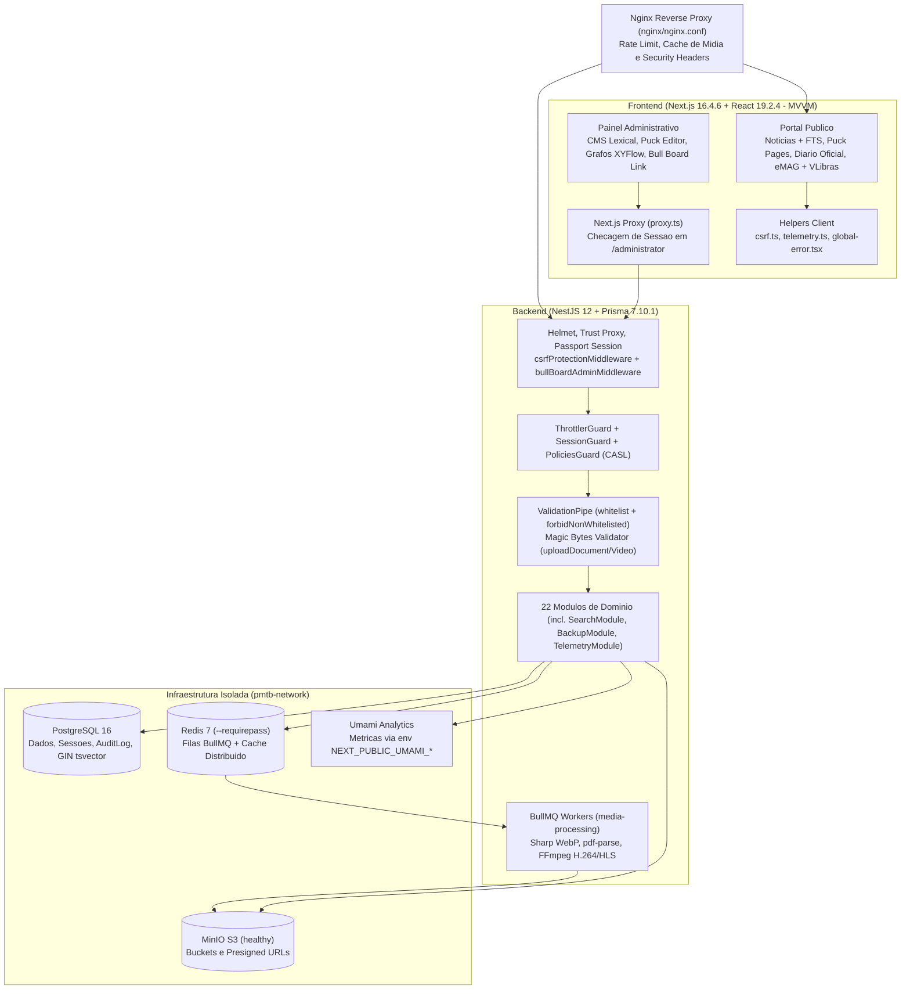

# Relatório Completo de Análise do Projeto — Auditoria Pós-TO-DO 2.0

**Data da Análise:** 18 de novembro de 2026  
**Escopo:** Revisão completa de Arquitetura, Stack e Dependências (`npm audit` / `pnpm audit`), Auditoria de Segurança (Vulnerabilidades, Vazamentos e Bypass de Fluxo) e Levantamento de Débitos Técnicos e Bugs Latentes após a conclusão integral dos **TO-DO 1.0 e TO-DO 2.0 (Fases 1 a 4)**.

---

## 1. Resumo Executivo e Evolução da Maturidade

Com a entrega das Fases 1 a 4 do [TODO.md](file:///d:/Site%20-%20Prefeitura/site-test/TODO.md), o portal evoluiu substancialmente em segurança de perímetro, observabilidade e automação:
- **Dependências de Produção do Backend:** Reduzidas de **15 vulnerabilidades** para **`0` vulnerabilidades** (`npm --prefix backend audit --omit=dev`).
- **Dependências de Produção do Frontend:** Reduzidas de **118 vulnerabilidades (6 críticas)** para **12 vulnerabilidades transitivas (`0` críticas, 7 altas, 4 moderadas, 1 baixa)**.
- **Testes Automatizados e Qualidade:** Suíte Vitest com **59/59 testes aprovados** em 11 arquivos no backend e **4/4 testes aprovados** no frontend (`test/portal.test.ts`), checagem `tsc --noEmit` limpa em ambos os projetos e pipeline CI/CD configurado em [.github/workflows/ci.yml](file:///d:/Site%20-%20Prefeitura/site-test/.github/workflows/ci.yml) + Husky/lint-staged.
- **Novos Achados desta Auditoria Profunda:** A revisão exaustiva de todos os controladores, serviços, middlewares e componentes React revelou **9 vulnerabilidades/brechas residuais de segurança e controle de acesso** (incluindo Stored XSS em blocos Puck, vazamento de rascunhos/inativos e e-mails em módulos secundários, contas `active: false` autenticáveis e 2FA/CSRF ainda parciais em runtime) e **6 débitos técnicos / bugs latentes** (incluindo 2 casos de *Route Shadowing* em NestJS, bug de `bannerId` no `GalleryMediaService` e sincronização incompleta de texto extraído de PDFs para o Diário Oficial).

---

## 2. Análise de Arquitetura Atualizada

### 2.1. Pontos Fortes Consolidados
- **Segregação de Rede e Storage:** PostgreSQL, Redis (com senha) e MinIO (healthcheck `healthy`) rodam apenas na rede interna Docker `pmtb-network` sem portas expostas no host ([docker-compose.yml](file:///d:/Site%20-%20Prefeitura/site-test/docker-compose.yml)); uploads e entregas passam via S3/MinIO e `os.tmpdir()`.
- **Proteção Global de Entrada e Filas:** `ValidationPipe` estrito global, `helmet`, `app.set('trust proxy', 1)`, validação síncrona de *magic bytes* em documentos e vídeos ([file-type-detector.ts](file:///d:/Site%20-%20Prefeitura/site-test/backend/src/common/utils/file-type-detector.ts)), painel `/admin/queues` isolado por `bullBoardAdminMiddleware` (`ADMIN`) e `TelemetryService` / `BackupService` operacionais.
- **Unificação de Editor e Busca:** Remoção do TipTap em prol do Lexical (inclusive em [puck.config.tsx](file:///d:/Site%20-%20Prefeitura/site-test/frontend/puck.config.tsx)), eliminação de UUIDs fixos de menus em favor de `useMenuByLocation` (`/menus/by/location/...`), migrations oficiais para índices GIN e módulo global [search.controller.ts](file:///d:/Site%20-%20Prefeitura/site-test/backend/src/search/search.controller.ts).

---

## 3. Análise de Stack e Dependências (Cruzada com Segurança)

### 3.1. Auditoria do Backend (`npm --prefix backend audit --omit=dev` vs `npm audit`)
- **Produção (`--omit=dev`):** **`0` vulnerabilidades encontradas**. O upgrade para `sharp@^0.35.5`, `@prisma/client@^7.10.1`, remoção de `fluent-ffmpeg` e `npm audit fix` zeraram todos os alertas de runtime.
- **Desenvolvimento (`devDependencies`):** Permanecem **23 vulnerabilidades (2 moderadas, 21 altas)** exclusivamente em ferramentas de build/teste (`vitest`/`@vitest/mocker`, `brace-expansion` e `picomatch` via `@nestjs/cli`, `typescript-eslint`, `unplugin-swc` e `ts-loader`). Não impactam o container em produção (`npm ci --omit=dev`), mas merecem atualização periódica do `@nestjs/cli` e `vitest` no CI.

### 3.2. Auditoria do Frontend (`pnpm --dir frontend audit --prod`) — **12 vulnerabilidades transitivas (0 críticas, 7 altas, 4 moderadas, 1 baixa)**
A retirada do `next@16.2.6` (para `16.4.6`) e a movimentação do `shadcn` CLI para `devDependencies` eliminaram **106 alertas** (inclusive todas as 6 críticas). Os **12 alertas remanescentes** vêm exclusivamente de subdependências transitivas do `@puckeditor/core` e do `next`:

| Origem Direta | Subdependência Vulnerável | Severidade | Advisory / Risco | Correção Recomendada |
| :--- | :--- | :--- | :--- | :--- |
| **`@puckeditor/core`** | `happy-dom` (também via `@tiptap/html` interno do Puck) | 🟠 **High (2) / Mod (1)** | `GHSA-834v-8h66-3h79` (execução de código via import alias), `GHSA-c8p4-j97h-3vg8` (SSRF), `GHSA-5fpq-26gf-qwcr` | Adicionar `pnpm.overrides` fixando `"happy-dom": ">=21.0.4"`. |
| **`@puckeditor/core`** | `@tiptap/core` e `prosemirror-view` (dependências internas do pacote `@puckeditor/core`) | 🟠 **High (2) / Mod (1)** | `GHSA-c8x8-7fp4-3x9w` (XSS em colagem no `prosemirror-view`), `GHSA-j95f-988m-3j2f` (ReDoS), `GHSA-cp6q-959q-f8rh` (`__proto__`) | Adicionar `pnpm.overrides` para `"@tiptap/core": ">=3.30.5"` e `"prosemirror-view": ">=1.42.3"`. |
| **`@puckeditor/core`** | `uuid` | 🟡 **Moderate (1)** | `GHSA-w5hq-g745-h8pq` (bounds check em v3/v5/v6) | Override para `"uuid": ">=11.1.1"`. |
| **`next`** | `source-map-js` (via `postcss`), `browserslist` e `@babel/core` (via `styled-jsx`) | 🟠 **High (3) / Mod (1) / Low (1)** | `GHSA-68fv-2mgg-jv7q` (DoS event-loop), `GHSA-c83g-rgw3-j3cx` / `GHSA-73wf-gq98-2v4g` (Browserslist OOM/prototype write), `GHSA-4x5r-pxfx-6jf8` | Override seguro no `frontend/package.json` (`"browserslist": ">=4.28.7"`, `"source-map-js": ">=1.2.2"`) ou acompanhar release patch do Next.js. |

---

## 4. Vulnerabilidades e Vazamentos Identificados na Auditoria Atual

### 🔴 Severidade Alta

#### 4.1. Stored XSS via `dangerouslySetInnerHTML` sem Sanitização (Blocos Puck `Texto` e `Embed` + `DynamicIcon`)
- **Localização:** [puck.config.tsx](file:///d:/Site%20-%20Prefeitura/site-test/frontend/puck.config.tsx#L367-L375), [puck.config.tsx](file:///d:/Site%20-%20Prefeitura/site-test/frontend/puck.config.tsx#L1104-L1109) e [dynamic-icon.tsx](file:///d:/Site%20-%20Prefeitura/site-test/frontend/components/icons/dynamic-icon.tsx#L16-L43).
- **Descrição:**
  - Os componentes `Texto` e `Embed` do Puck renderizam strings HTML armazenadas no banco diretamente com `dangerouslySetInnerHTML={{ __html: ... }}` sem sanitização com `DOMPurify` (`isomorphic-dompurify`).
  - O componente `DynamicIcon` busca `src` via `fetch(src)` sem validar `res.ok` e injeta o retorno via `dangerouslySetInnerHTML` aplicando apenas 3 regex simples (que não bloqueiam `<script>`, `onload=`, `<foreignObject>` ou respostas `404` HTML).
- **Impacto:** Qualquer usuário editorial autenticado (ex.: perfil `USER` de uma secretaria criando páginas ou conta editorial comprometida) consegue persistir `` no bloco `Texto` ou `<iframe>`/`<script>` arbitrários no bloco `Embed`, executando JavaScript no navegador de cidadãos e administradores autenticados (*Stored XSS*).
- **Correção Recomendada:** Sanitizar todo HTML de `Texto` com `isomorphic-dompurify` antes de renderizar; restringir `Embed` a uma *allowlist* estrita de domínios/iframes confiáveis (YouTube, Google Maps, Gov.br) com `sandbox`; validar `res.ok` e sanitizar SVGs com `DOMPurify` (`USE_PROFILES: { svg: true }`) em `DynamicIcon`.

#### 4.2. Exposição Pública de Rascunhos, Inativos e Itens Expirados em `Popups`, `Galleries` e `Story`
- **Localização:** [popups.controller.ts](file:///d:/Site%20-%20Prefeitura/site-test/backend/src/popups/popups.controller.ts#L24-L32), [popups.service.ts](file:///d:/Site%20-%20Prefeitura/site-test/backend/src/popups/popups.service.ts#L62-L87), [galleries.controller.ts](file:///d:/Site%20-%20Prefeitura/site-test/backend/src/galleries/galleries.controller.ts#L24-L32), [galleries.service.ts](file:///d:/Site%20-%20Prefeitura/site-test/backend/src/galleries/galleries.service.ts#L34-L59) e [story.service.ts](file:///d:/Site%20-%20Prefeitura/site-test/backend/src/story/story.service.ts#L204-L239).
- **Descrição:** Enquanto `ArticlesService` e `PagesService` já separam listagens públicas (filtrando `status: 'publicado'` / `published: true` e datas de vigência) de listagens administrativas protegidas por guard, as rotas públicas:
  - `GET /popups` e `GET /popups/:id` retornam popups com `active: false`, `status: 'rascunho'`, `'arquivado'`, `'expirado'` ou `'excluido'`;
  - `GET /galleries` e `GET /galleries/:id` retornam galerias inativas (`active: false`);
  - `StoryService.findAllStoryItems()` e `findStoryItemById()` não aplicam o filtro de vigência (`publishedDate <= now <= expirationDate`) usado em `findAllStoryItemsByStoryId`.
- **Correção Recomendada:** Separar endpoints `/admin` (com `SessionGuard + PoliciesGuard`) das rotas públicas, aplicando filtros obrigatórios de `active: true`, `status: 'publicado'` e janela de `publicationDate` / `expirationDate` nas leituras anônimas.

---

### 🟠 Severidade Média

#### 4.3. Vazamento de E-mails de Servidores em `GET /galleries` e `GET /galleries/:id` (LGPD)
- **Localização:** [galleries.service.ts](file:///d:/Site%20-%20Prefeitura/site-test/backend/src/galleries/galleries.service.ts#L40) e [galleries.service.ts](file:///d:/Site%20-%20Prefeitura/site-test/backend/src/galleries/galleries.service.ts#L52).
- **Descrição:** Ambos os métodos públicos utilizam `user: { select: { name: true, email: true, avatar: true } }`, expondo os endereços de e-mail corporativos dos servidores públicos que cadastraram galerias.
- **Correção Recomendada:** Remover `email: true`, mantendo apenas `{ name: true, avatar: true }` (como já padronizado em `Articles`, `Pages`, `Services` e `Popups`).

#### 4.4. Contas Desativadas (`active: false`) Ainda Podem Autenticar e Manter Sessão Ativa
- **Localização:** [auth.service.ts](file:///d:/Site%20-%20Prefeitura/site-test/backend/src/auth/auth.service.ts#L15-L23) e [session.serializer.ts](file:///d:/Site%20-%20Prefeitura/site-test/backend/src/auth/session.serializer.ts#L15-L25).
- **Descrição:** Embora `GovBrOAuthService` verifique `!user || !user.active`, o login tradicional por senha em `AuthService.validateUser()` e a hidratação de sessão em `SessionSerializer.deserializeUser()` não checam `user.active === true`.
- **Impacto:** Um servidor exonerado ou bloqueado pelo administrador (`active: false`) continua conseguindo fazer login ou usar sua sessão `connect.sid` antiga até que ela expire.
- **Correção Recomendada:** Rejeitar usuários com `!user.active` em `AuthService.validateUser()` e invalidar a sessão (`done(null, null)`) em `SessionSerializer.deserializeUser()`.

#### 4.5. 2FA/TOTP (Adiado para Pós-Lançamento) e Fluxo de Ativação de Conta por E-mail
- **Decisão de Produto:** Por ora, o 2FA/TOTP (`otplib`) e o Login Único Gov.br foram removidos desta etapa (Gov.br descontinuado pois os serviços ao cidadão residem em portal terceiro e o dashboard é restrito a servidores internos; 2FA/TOTP registrado no roadmap pós-lançamento do site teste).
- **Solução Adotada (TO-DO 3.0):** Substituição imediata por **Ativação de Conta via Link Único com Definição de Senha**: usuário criado por um `ADMIN` inicia inativo (`active: false`), recebe link por e-mail com validade temporal (`activationTokenExpiresAt`) e limite de 1 uso (`activationTokenMaxUses = 1`), sendo ativado após definir sua senha. Contas inativas são bloqueadas em `AuthService.validateUser` e `SessionSerializer.deserializeUser`.

#### 4.6. CSRF em Modo Permissivo por Padrão e Frontend sem Envio Automático do Header `X-CSRF-Token`
- **Localização:** [csrf.middleware.ts](file:///d:/Site%20-%20Prefeitura/site-test/backend/src/common/middleware/csrf.middleware.ts) e [frontend/app/service/](file:///d:/Site%20-%20Prefeitura/site-test/frontend/app/service).
- **Decisão de Produto (TO-DO 3.0):** Todos os `fetch` de mutação (`POST`, `PUT`, `PATCH`, `DELETE`) nos serviços do frontend serão migrados para `csrfFetch` (com obtenção automática de `/auth/csrf-token` e envio do header `X-CSRF-Token`), permitindo remover o modo permissivo do `csrfProtectionMiddleware` no backend.

#### 4.7. Sobrescrita de Autoria Original (`userId`) em `ServicesService.update`
- **Localização:** [services.service.ts](file:///d:/Site%20-%20Prefeitura/site-test/backend/src/service/services.service.ts#L72-L77).
- **Descrição:** Ao editar um serviço, `ServicesService.update` faz `data: { ...updateServiceDto, userId }`, sobrescrevendo o criador original pelo usuário editor (problema equivalente ao já corrigido em `ArticlesService`).
- **Correção Recomendada:** Remover `userId` do `update`, mantendo a autoria original imutável (a auditoria já registra quem editou em `AuditLog`).

#### 4.8. Acesso Irrestrito a URLs Pré-assinadas de Qualquer Chave S3 em `GET /media/presigned/*path`
- **Localização:** [media.controller.ts](file:///d:/Site%20-%20Prefeitura/site-test/backend/src/media/media.controller.ts#L110-L119).
- **Descrição:** Ao contrário de `GET /media/file/*path` (que valida existência no banco e `media.status === 'ready'`), `GET /media/presigned/*path` gera URL pré-assinada do MinIO para qualquer string `key` informada publicamente na URL, sem autenticação nem verificação de registro `ready` ou prevenção de *path traversal* (`..`).

---

### 🟡 Severidade Baixa

#### 4.9. Ausência de Validação de Limite/Página em Rotas Públicas e Pós-Lançamento (2FA/Gov.br Removido)
- **Localização:** [services.service.ts](file:///d:/Site%20-%20Prefeitura/site-test/backend/src/service/services.service.ts#L17-L30), [story.controller.ts](file:///d:/Site%20-%20Prefeitura/site-test/backend/src/story/story.controller.ts#L48-L68) e [media.controller.ts](file:///d:/Site%20-%20Prefeitura/site-test/backend/src/media/media.controller.ts#L121-L141).
- **Descrição:**
  - `ServicesService.findAllPublic` e `StoryController.findAllStories` aceitam `limit` sem teto máximo (um atacante pode enviar `?limit=1000000`), e `StoryController` permite `page <= 0` causando `skip < 0` no Prisma (erro 500).
  - `GET /galleries`, `GET /popups`, `GET /services` e `GET /media/list/*prefix` ainda operam sem teto máximo (`maxTake`) ou paginação padronizada por `resolvePagination`.
  - *(Nota: Login Gov.br foi removido do escopo pois todos os serviços ao munícipe estão em portal terceiro e o dashboard atende apenas servidores; o 2FA/TOTP foi movido para roadmap pós-lançamento do site teste.)*

---

## 5. Débitos Técnicos e Bugs Latentes Identificados

1. **[BUG] *Route Shadowing* em `MediaController` e `StoryController`:**
   - Em [media.controller.ts](file:///d:/Site%20-%20Prefeitura/site-test/backend/src/media/media.controller.ts#L276-L298), `@Get(':id')` está declarado **antes** de `@Get('images')`, `@Get('documents')` e `@Get('videos')`. Na prática, todas as chamadas a `GET /media/images`, `GET /media/documents` e `GET /media/videos` caem em `findOne('images' | 'documents' | 'videos')` e falham buscando um UUID inexistente.
   - Em [story.controller.ts](file:///d:/Site%20-%20Prefeitura/site-test/backend/src/story/story.controller.ts#L70-L140), `@Get(':id')` (sem `ParseUUIDPipe`) está declarado antes de `@Get('items')`, capturando `GET /story/items` com `id = 'items'`.

2. **[BUG] Campo `bannerId` Inexistente no Schema Quebra `POST /gallery-media`:**
   - Em [gallery-media.service.ts](file:///d:/Site%20-%20Prefeitura/site-test/backend/src/gallery-media/gallery-media.service.ts#L11-L20) e [create-gallery-media.dto.ts](file:///d:/Site%20-%20Prefeitura/site-test/backend/src/gallery-media/dto/create-gallery-media.dto.ts#L4-L7), o código exige `CreateGalleryMediaDto.bannerId` e envia `data: CreateGalleryMediaDto as any` ao Prisma. Porém, no [schema.prisma](file:///d:/Site%20-%20Prefeitura/site-test/backend/prisma/schema.prisma#L333-L351), o campo da tabela `gallery_media` é **`galleryId`** (não existe coluna `bannerId`). Qualquer chamada a `POST /gallery-media` falhará com `PrismaClientValidationError` ou `bannerId is required`.

3. **[DÉBITO] Sincronização entre `Media.extractedText` e `OfficialGazette.contentText`:**
   - Na Fase 4, `MediaProcessor` passou a salvar o texto extraído de PDFs em `Media.extractedText`, e `OfficialGazetteService.searchByFullText` passou a indexar `OfficialGazette.contentText` (que também aceita envio opcional no `CreateOfficialGazetteDto`). Porém, como `OfficialGazette` relaciona-se com o PDF apenas por `fileUrl` (sem FK para `Media`) e o upload em `MediaProcessor` ocorre de forma assíncrona, falta um vínculo ou *event listener* (`media.ready`) que copie automaticamente `Media.extractedText` para `OfficialGazette.contentText` após o término do processamento assíncrono do PDF.

4. **[DÉBITO] Boot Lento / N+1 em `FoldersService.onModuleInit`:**
   - [folders.service.ts](file:///d:/Site%20-%20Prefeitura/site-test/backend/src/media/folders.service.ts#L20-L87) executa `migrateLegacyMedia()` em toda inicialização da API fazendo queries `findMany({ where: { folderId: null } })` e múltiplos `findUnique`/`create`/uploads S3 sequenciais dentro do ciclo síncrono de boot do NestJS. Se houver centenas de mídias sem pasta ou o MinIO estiver momentaneamente lento, atrasará a disponibilidade da aplicação.

5. **[DÉBITO] Qualidade de Código e Tipagem/Nomenclatura Secundária:**
   - Typo no nome de arquivo `backend/src/service/dto/update-serviecs.dto.ts`.
   - `GalleryMediaController` protege `GalleryMedia` usando o subject `'Galleries'` em vez de `'GalleryMedia'` (embora ambos existam no `CaslAbilityFactory`).
   - `tsconfig.build.tsbuildinfo` e `tsconfig.tsbuildinfo` versionados no Git são modificados a cada execução de `nest start --watch` / `tsc`, exigindo limpeza antes dos commits (ideal adicioná-los ao `.gitignore` com `git rm --cached`).

6. **[DÉBITO] Execução Real de E2E Playwright e Overrides no Frontend:**
   - Adicionar bloco `pnpm.overrides` em `frontend/package.json` resolverá os últimos **12 avisos transitivos** do `pnpm audit --prod`.
   - No workflow [.github/workflows/ci.yml](file:///d:/Site%20-%20Prefeitura/site-test/.github/workflows/ci.yml#L73-L76), o passo do Playwright atualmente apenas lista os testes (`playwright test --list`); vale evoluir para subir o servidor Next.js (`pnpm start &`) e rodar `pnpm exec playwright test` contra rotas públicas renderizadas.

---

## 6. Roadmap Redefinido (TO-DO 3.0 e Pós-Lançamento)

| Prioridade / Fase | Ação | Arquivos-Alvo |
| :--- | :--- | :--- |
| **TO-DO 3.0 — Nível 1 (Auth & Ativação)** | Remover Login Gov.br e 2FA (`otplib`); implementar Ativação de Conta por E-mail (criação por ADMIN → disparo de link com expiração + 1 uso máximo → definição de senha → ativação `active: true`; bloqueio de inativos no login/sessão e reenvio por ADMIN). | `schema.prisma`, `auth.controller.ts`, `auth.service.ts`, `session.serializer.ts`, `user.service.ts`, `user.controller.ts`, `mail.service.ts`, `frontend/app/(pages)/(public)/ativar-conta/page.tsx` |
| **TO-DO 3.0 — Nível 2 (CSRF Estrito)** | Criar `csrfFetch` com obtenção automática de `/auth/csrf-token`, atualizar os 14 serviços de mutação do frontend e remover o bypass permissivo de `csrfProtectionMiddleware`. | `frontend/lib/csrf.ts`, `frontend/app/service/*.ts`, `csrf.middleware.ts` |
| **TO-DO 3.0 — Nível 3 (P0 XSS & Bugs)** | Sanitizar HTML em `Texto`, `Embed` e `DynamicIcon`; corrigir *Route Shadowing* em `MediaController` e `StoryController`; corrigir `bannerId` → `galleryId` em `GalleryMedia`. | `frontend/lib/sanitize-html.ts`, `frontend/puck.config.tsx`, `dynamic-icon.tsx`, `media.controller.ts`, `story.controller.ts`, `gallery-media.service.ts` |
| **TO-DO 3.0 — Nível 3 (P1 LGPD & Presigned)** | Remover `email` de `GalleriesService`, manter `userId` imutável em `ServicesService.update`, validar `key`/`status === 'ready'` e path traversal em `GET /media/presigned/*path`, limitar `limit` (máx. 100) em paginações públicas. | `galleries.service.ts`, `services.service.ts`, `story.controller.ts`, `media.controller.ts` |
| **Pós-Lançamento (Site Teste)** | Reimplantar 2FA/TOTP persistido em banco para `ADMIN`/`PUBLISHER`; vincular `Media.extractedText` → `OfficialGazette.contentText`; aplicar `pnpm.overrides` no frontend; rodar E2E Playwright completo no CI. | `schema.prisma`, `media.processor.ts`, `frontend/package.json`, `.github/workflows/ci.yml` |
