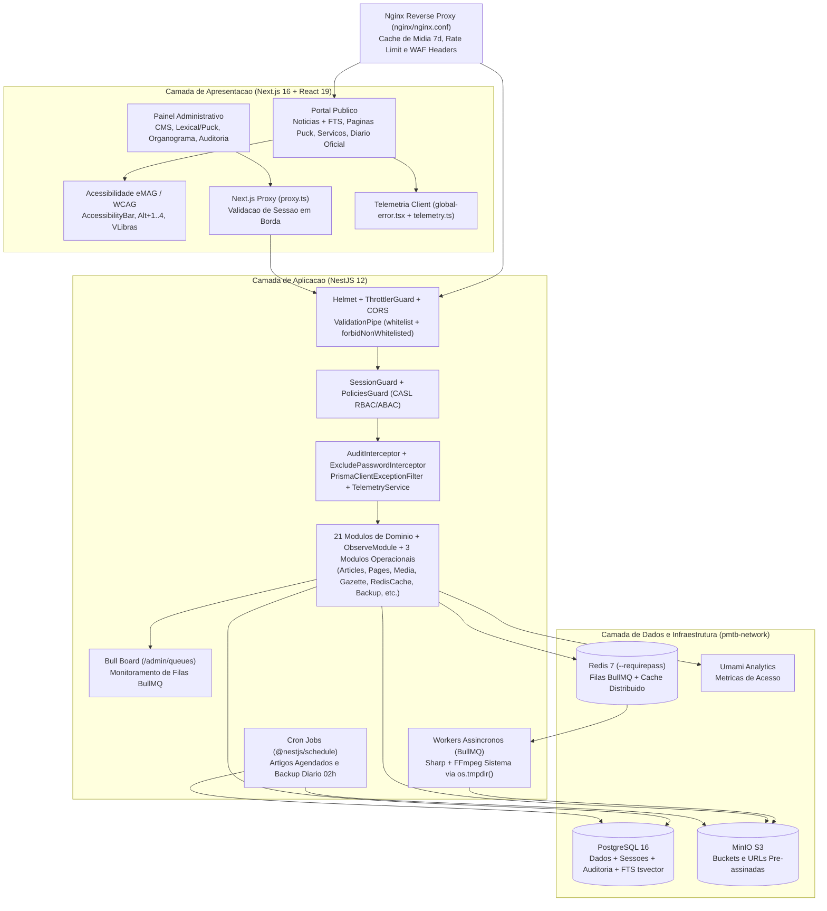

# Relatório Completo de Análise do Projeto — Portal Institucional da Prefeitura

**Data da Análise:** 17 de novembro de 2026 (Revisão Pós-Refatoração — Fases 1 a 4 Concluídas)  
**Escopo:** Análise de Arquitetura Atualizada, Stack e Dependências (cruzadas com `npm audit` / `pnpm audit`), Balanço de Vulnerabilidades e Brechas Residuais, e Roadmap de Ferramentas Futuras.

---

## 1. Análise de Arquitetura

### 1.1. Visão Geral da Solução (Pós-Fases 1 a 4)
O projeto mantém uma arquitetura **Monorepo Multi-serviço** (**Frontend** Next.js + **Backend** NestJS), agora complementada por uma camada de **Proxy Reverso e Cache de Borda (Nginx)**, **Cache Distribuído (Redis)**, **Telemetria Estruturada**, **Painel Visual de Filas (Bull Board)**, **Backup Automatizado** e **Suite de Acessibilidade Governamental (eMAG/VLibras)**.

### 1.2. Arquitetura do Frontend (`/frontend`)
- **Padrão MVVM (Model-View-ViewModel):**
  - **Model (`app/type/`):** Contratos TypeScript de domínio (`IArticle`, `IPage`, `IMedia`, `IOrganization`, `IUser`, etc.).
  - **Service (`app/service/`):** Chamadas HTTP desacopladas (`fetch` com `credentials: "include"`) e sanitização de payloads na origem (ex.: `user.service.ts`, `popups.service.ts`).
  - **ViewModel (`app/viewmodel/`):** Hooks com `@tanstack/react-query` (cache, paginação e mutações) e `@tanstack/react-table` (ex.: listagem pública de notícias com filtros de categoria, intervalo de datas via Shadcn Calendar, autor, tipo, ordenação e carregamento incremental/paginação).
  - **View (`components/` e `app/(pages)/`):** Área pública e painel administrativo sob `/administrator`, protegidos na borda pelo middleware [proxy.ts](file:///d:/Site%20-%20Prefeitura/site-test/frontend/proxy.ts#L3-L38).
- **Construção Dinâmica e Acessibilidade (eMAG / WCAG 2.1 AA):**
  - **Puck Editor (`@puckeditor/core`):** Montagem visual de páginas institucionais (`puck.config.tsx`) renderizadas em `[...puckPath]`, com grafo organizacional em `@xyflow/react` + `@dagrejs/dagre`.
  - **Camada de Acessibilidade Pública ([layout.tsx](file:///d:/Site%20-%20Prefeitura/site-test/frontend/app/(pages)/(public)/layout.tsx#L12-L22)):** Barra [accessibility-bar.tsx](file:///d:/Site%20-%20Prefeitura/site-test/frontend/components/public/accessibility-bar.tsx) com atalhos de teclado (`Alt+1` a `Alt+4`), escalonamento tipográfico persistente (`85%` a `130%`), modo `.high-contrast` e widget [vlibras-widget.tsx](file:///d:/Site%20-%20Prefeitura/site-test/frontend/components/public/vlibras-widget.tsx).
- **Resiliência e Testes E2E:**
  - Error boundary global [global-error.tsx](file:///d:/Site%20-%20Prefeitura/site-test/frontend/app/global-error.tsx) conectado a [telemetry.ts](file:///d:/Site%20-%20Prefeitura/site-test/frontend/lib/telemetry.ts) (suporte opcional a `NEXT_PUBLIC_SENTRY_DSN`).
  - Suíte E2E configurada com Playwright em [portal.spec.ts](file:///d:/Site%20-%20Prefeitura/site-test/frontend/e2e/portal.spec.ts).

### 1.3. Arquitetura do Backend (`/backend`)
- **Modularização e Blindagem Global:**
  - Conforme [app.module.ts](file:///d:/Site%20-%20Prefeitura/site-test/backend/src/app.module.ts#L39-L95), o núcleo reúne **21 módulos de domínio/persistência** (`Auth`, `Prisma`, `Casl`, `Pages`, `Articles`, `Media`, `Menu`, `Organizations`, `Spaces`, `Categories`, `Galleries`, `GalleryMedia`, `Popups`, `Services`, `Story`, `MenuItem`, `User`, `Settings`, `Analytics`, `Audit`, `OfficialGazette`), o módulo de instrumentação `ObserveModule` e **3 novos módulos operacionais globais**:
    - [redis-cache.service.ts](file:///d:/Site%20-%20Prefeitura/site-test/backend/src/common/cache/redis-cache.service.ts): cache em Redis (`ioredis`) com fallback automático em memória e invalidação por prefixo (`SCAN` + `DEL`), aplicado em `MenusService`, `MenuItemService`, `SettingsService` e `PagesService`.
    - [telemetry.service.ts](file:///d:/Site%20-%20Prefeitura/site-test/backend/src/common/telemetry/telemetry.service.ts): correlação de falhas (`traceId`/`spanId`) acoplada ao `PrismaClientExceptionFilter`.
    - [backup.service.ts](file:///d:/Site%20-%20Prefeitura/site-test/backend/src/backup/backup.service.ts) e [backup.sh](file:///d:/Site%20-%20Prefeitura/site-test/scripts/backup.sh): cron diário (`02h00`) e endpoints administrativos (`POST /backup/run`, `GET /backup/status`) restritos a `ADMIN`.
  - Validação *fail-fast* de variáveis de ambiente com Zod em [env.validation.ts](file:///d:/Site%20-%20Prefeitura/site-test/backend/src/common/config/env.validation.ts) no boot ([main.ts](file:///d:/Site%20-%20Prefeitura/site-test/backend/src/main.ts#L18)).
- **Armazenamento Desacoplado, Paginação e Full-Text Search:**
  - **Storage S3 puro:** O volume compartilhado `bucket_data` e o servidor estático `/uploads/` foram removidos do backend; o [MediaProcessor](file:///d:/Site%20-%20Prefeitura/site-test/backend/src/media/media.processor.ts) processa arquivos em `os.tmpdir()` e envia ao MinIO via SDK S3, com suporte a URLs pré-assinadas (`GET /media/presigned/*path`).
  - **Paginação Server-Side Obrigatória:** Helper [pagination.ts](file:///d:/Site%20-%20Prefeitura/site-test/backend/src/common/utils/pagination.ts) (`defaultTake = 50`, `maxTake = 100`) aplicado em `GET /articles/admin`, `GET /pages` e `GET /media`.
  - **Full-Text Search em Português:** Método `searchByFullText` com `to_tsvector('portuguese', ...)` e `plainto_tsquery('portuguese', ...)` integrado diretamente em `ArticlesService` e `OfficialGazetteService`, acompanhado de script de índices GIN em [fulltext-search.sql](file:///d:/Site%20-%20Prefeitura/site-test/backend/prisma/fulltext-search.sql).
- **Cobertura de Testes Automatizados:**
  - Suíte Backend em Vitest validada nesta análise com **7 arquivos e 34 testes aprovados (100%)** (`app.controller.spec.ts`, `settings.*.spec.ts`, `security-phase1.spec.ts`, `security-phase2.spec.ts`, `architecture-phase3.spec.ts` e `features-phase4.spec.ts`).

### 1.4. Débitos Técnicos Arquiteturais Remanescentes
1. **Duplicidade de Editores Rich-Text no Frontend ([frontend/package.json](file:///d:/Site%20-%20Prefeitura/site-test/frontend/package.json#L21-L36)):** Mantém simultaneamente `@lexical/*` (`^0.44.0`) e `@tiptap/*` (`^3.27.1`), inflando o bundle JavaScript e adicionando superfície de vulnerabilidades (ver Seção 2.2).
2. **Dependência Órfã `fluent-ffmpeg` no Backend ([backend/package.json](file:///d:/Site%20-%20Prefeitura/site-test/backend/package.json#L48)):** Apesar da remoção de `@ffmpeg-installer/ffmpeg` e da inclusão de `ffmpeg` no Alpine ([dockerfile](file:///d:/Site%20-%20Prefeitura/site-test/backend/dockerfile#L4)), o pacote depreciado `fluent-ffmpeg@^2.1.3` segue listado em `dependencies` sem importações em `backend/src`. Além disso, `ioredis` é importado diretamente em [redis-cache.service.ts](file:///d:/Site%20-%20Prefeitura/site-test/backend/src/common/cache/redis-cache.service.ts#L2) sem estar declarado nas `dependencies` do `package.json` (dependendo de *hoisting* do `bullmq`).
3. **UUIDs de Menus Hardcoded no Layout Público ([header.tsx](file:///d:/Site%20-%20Prefeitura/site-test/frontend/components/public/header.tsx#L23-L133), [footer.tsx](file:///d:/Site%20-%20Prefeitura/site-test/frontend/components/public/footer.tsx#L12)):** Os componentes `DesktopBarTop` (`a80c8356-9cfc-4998-8b5c-c81f395f6dcd`), `DesktopHeader` (`dec03c06-aa22-4ceb-9dc0-38d445671d68`) e `Footer` (`efc07819-7131-46ed-9322-0fe352c9b92e`) dependem de UUIDs fixos do banco de dados em vez de consultar menus por `location` (`GET /menus/by/location/...`). Isso torna deploys em bancos novos ou ambientes de homologação frágeis.
4. **URL e Website ID do Umami Hardcoded ([layout.tsx](file:///d:/Site%20-%20Prefeitura/site-test/frontend/app/layout.tsx#L30-L35)):** O `<Script>` do Umami aponta diretamente para `http://localhost:3002/script.js` com `data-website-id` estático em vez de ler `NEXT_PUBLIC_UMAMI_URL` e `NEXT_PUBLIC_UMAMI_WEBSITE_ID`.
5. **Inconsistência de Case-Sensitivity no Dockerfile ([docker-compose.yml](file:///d:/Site%20-%20Prefeitura/site-test/docker-compose.yml#L45) vs [backend/dockerfile](file:///d:/Site%20-%20Prefeitura/site-test/backend/dockerfile)):** O arquivo no diretório `backend/` chama-se `dockerfile` (minúsculo), mas o `docker-compose.yml` referencia `dockerfile: Dockerfile` (maiúsculo). No Windows (NTFS) funciona por tolerância a maiúsculas/minúsculas, porém falhará em servidores Linux (`docker compose build`).
6. **Diretório Vazio `backend/src/search` e Aplicação Manual do Índice GIN:** A busca Full-Text está distribuída em `ArticlesService` e `OfficialGazetteService`, deixando `backend/src/search` vazio (sem endpoint global unificado `/search`), e o script [fulltext-search.sql](file:///d:/Site%20-%20Prefeitura/site-test/backend/prisma/fulltext-search.sql) exige execução manual fora do fluxo automático de `prisma migrate`. No frontend, a suíte unitária Vitest (`pnpm --dir frontend test`) ainda não possui arquivos em `./test/**/*.test.{ts,tsx}`.

---

## 2. Análise de Stack e Dependências (Cruzada com Segurança)

### 2.1. Stack Tecnológica Atualizada
| Camada | Tecnologia | Versão no Projeto | Estado / Observação |
| :--- | :--- | :--- | :--- |
| **Frontend Framework** | Next.js (App Router) | `16.2.6` | **Requer patch urgente** (`>= 16.4.1` para mitigar 5 CVEs críticos de RCE) |
| **UI Library & Design** | React / Tailwind CSS v4 / Radix UI | `19.2.4` / `^4` / `^1.4.3` | Atualizado (`shadcn` CLI deve sair de `dependencies`) |
| **Estado e Dados** | TanStack Query v5 + TanStack Table v8 | `^5.100.10` / `^8.21.3` | Sólido e atualizado |
| **Editores e CMS** | Puck Editor + Lexical + TipTap | `^0.21.2` / `^0.44.0` / `^3.27.1` | Redundância entre Lexical e TipTap; TipTap/Puck com CVEs transitivos |
| **Backend Framework** | NestJS | `^12.0.0` | Robusto; protegido com `helmet@^8.3.0`, `@nestjs/throttler@^6.8.0` e `zod@^4.6.7` |
| **ORM e Banco** | Prisma ORM + PostgreSQL | `^7.8.0` / `PG 16` | Atualização recomendada para `>= 7.10.1` (CVEs transitivos da CLI) |
| **Autenticação / Acesso** | Passport + `express-session` + CASL | `^0.7.0` / `^1.18.2` / `^6.8.1` | Cookies hardened + CASL RBAC/ABAC |
| **Filas e Monitoramento** | BullMQ + Redis 7 + Bull Board | `^5.77.4` / `^9.13.2` | Pacotes órfãos removidos (`kafkajs`, `socket.io`, ES); Bull Board sem auth Express |
| **Mídia e Imagens** | `sharp` + `ffmpeg` (Alpine) | `^0.34.5` | `sharp` requer upgrade para `^0.35.5` (CVEs de `libvips`/`libheif`/`librsvg`) |
| **Proxy e QA** | Nginx (`nginx.conf`) + Playwright | `nginx` / `^1.65.1` | Proxy/WAF de borda + E2E configurados na Fase 4 |

### 2.2. Auditoria de Segurança das Dependências (`npm audit` e `pnpm audit`)

#### Backend (`npm --prefix backend audit --omit=dev`) — **15 vulnerabilidades (10 High, 3 Moderate, 2 Low)**
| Pacote / Origem | Severidade | Advisories / CVEs Principais | Risco Técnico e Correção Recomendada |
| :--- | :--- | :--- | :--- |
| **`sharp@0.34.5`** (`dependencies`) | 🔴 **High** | `GHSA-f88m-g3jw-g9cj` (`CVE-2026-33327`, `CVE-2026-33328`, `CVE-2026-35590`, `CVE-2026-35591` em `libvips`), `GHSA-rgj7-g3m4-5g8c` (`libheif`), `GHSA-wq5f-xc86-pv6w` (`librsvg` `CVE-2026-96889`) | Corrupção de memória/DoS ao processar imagens malformadas no `MediaProcessor`. **Correção:** Atualizar para `sharp@^0.35.5` (`npm audit fix --force` com teste de regressão de upload). |
| **`multer@2.1.1`** (via `@nestjs/platform-express` e `devDependencies`) | 🔴 **High** | `GHSA-q7qp-rjg7-q26m` | Negação de Serviço (DoS) por `fileFilter` assíncrono pendente após queda prematura da requisição multipart. **Correção:** `npm audit fix` (`>= 2.4.1`). |
| **`fast-xml-parser <= 5.11.2`** (via `@aws-sdk/xml-builder`) | 🟠 **High / Mod** | `GHSA-474x-hrwr-fgx4` | Consumo quadrático de CPU ao parsear XMLs de resposta S3 com tags não terminadas. **Correção:** `npm audit fix`. |
| **`fast-uri` (`3.0.0 - 3.1.8`)** | 🔴 **High** | `GHSA-v2hh-gcrm-f6hx`, `GHSA-f65p-4m7j-42xc` (e mais 9 advisories) | *Host confusion*, *scheme spoofing* e potencial SSRF na normalização de URIs. **Correção:** `npm audit fix` (`>= 3.1.9`). |
| **`prisma@7.8.0` / `@prisma/config` / `@prisma/dev`** | 🔴 **High / Mod** | Pull transitivo de `hono <= 4.13.15` (XSS, bypass de IP/CORS/path), `@hono/node-server <= 2.1.2`, `mysql2 <= 3.23.0`, `deepmerge-ts < 8.0.0` e `valibot <= 1.4.1` | Superfície elevada de dependência transitiva na toolchain Prisma. **Correção:** Atualizar `prisma`, `@prisma/client` e `@prisma/adapter-pg` para `>= 7.10.1` + `npm audit fix`. |
| **`source-map-js` (`1.0.0 - 1.2.1`)** | 🔴 **High** | `GHSA-68fv-2mgg-jv7q` | Bloqueio do *event loop* (DoS) via offsets de source-map. **Correção:** `npm audit fix`. |

#### Frontend (`pnpm --dir frontend audit --prod`) — **118 vulnerabilidades (6 Critical, 44 High, 60 Moderate, 8 Low)**
| Pacote / Origem | Severidade | Advisories / CVEs Principais | Risco Técnico e Correção Recomendada |
| :--- | :--- | :--- | :--- |
| **`next@16.2.6`** (`dependencies`) | 🔴 **Critical (5) / High** | `GHSA-p293-qw3h-jr36` (RCE não autenticado em servidores Windows), `GHSA-2xp9-vwfh-vxw4` (RCE em Image Optimization AVIF), `GHSA-vcvr-r3jv-pc5j` (RCE em `next/og`), `GHSA-2464-fhr4-w9xw` (RCE em Image Optimization SVG), `GHSA-673q-mjm6-r5xr` (RCE em `use cache`), `GHSA-6gpp-xcg3-4w24` (Bypass de Middleware/Proxy) + SSRF/DoS | Risco crítico de execução remota de código e bypass de proteção de borda (`proxy.ts`). **Correção Imediata:** Atualizar `next` e `eslint-config-next` para **`>= 16.4.1`**. |
| **`shadcn@4.7.0` em `dependencies`** ([frontend/package.json#L53](file:///d:/Site%20-%20Prefeitura/site-test/frontend/package.json#L53)) | 🔴 **Critical (1) / High** | Via CLI em produção puxa `proxy-addr` (**Critical** `GHSA-jqcg-44mw-7w3h` IP spoofing), `@modelcontextprotocol/sdk` (6 advisories), `hono` (26 advisories), `express`, `body-parser`, `ip-address`, `js-yaml`, `ts-morph`, `brace-expansion` | Pacote de linha de comando (dev-time) incluído no bundle/instalação de produção, respondendo pela maior parte dos 118 alertas. **Correção Imediata:** Mover `shadcn` para `devDependencies` (ou executar apenas via `pnpm dlx shadcn`). |
| **`@tiptap/*` + `@puckeditor/core`** | 🟠 **High** | `prosemirror-view` XSS ao colar HTML (`GHSA-c8x8-7fp4-3x9w`), `@tiptap/core` Quadratic ReDoS (`GHSA-j95f-988m-3j2f`) e `happy-dom` via `@puckeditor/core` (`GHSA-834v-8h66-3h79` RCE e `GHSA-c8p4-j97h-3vg8` SSRF) | XSS no editor administrativo e risco em renderização/parse HTML caso `happy-dom` processe entradas não confiáveis. **Correção:** Atualizar `@tiptap/*` para `>= 3.30.5` / `prosemirror-view >= 1.42.3`, aplicar override/update para `happy-dom >= 21.0.4` e remover o editor redundante. |
| **`sharp`, `postcss`, `source-map-js`, `nanoid`** | 🟠 **High** | Mesmas famílias de `sharp` (`libvips`/`librsvg`) e `postcss`/`source-map-js` (`GHSA-6g55-p6wh-862q`, `GHSA-r28c-9q8g-f849`) | Mitigado em conjunto ao atualizar `next` e rodar `pnpm update`. |

---

## 3. Vulnerabilidades e Vazamentos (Balanço Pós-Refatoração + Brechas Residuais)

### 3.1. Vulnerabilidades Mitigadas nas Fases 1 a 4
Todas as 11 falhas originais foram corrigidas e cobertas por testes automatizados no backend (`34/34` testes aprovados):
- **Críticas Resolvidas:** Segredo de sessão hardcoded removido + validação Zod de `SESSION_SECRET >= 64` chars ([env.validation.ts](file:///d:/Site%20-%20Prefeitura/site-test/backend/src/common/config/env.validation.ts)); rota `POST /auth/register` restringida a administradores com CASL; *Mass Assignment* bloqueado globalmente com `ValidationPipe({ whitelist: true, forbidNonWhitelisted: true, transform: true })` ([main.ts](file:///d:/Site%20-%20Prefeitura/site-test/backend/src/main.ts#L65-L71)) e mapeamento explícito nos serviços.
- **Altas Resolvidas:** Endpoints admin/rascunho (`GET /articles/id/:id`, `GET /pages`, `GET /pages/:id`, `AnalyticsController`, `MediaController`) protegidos com `SessionGuard + PoliciesGuard`; credenciais movidas do `docker-compose.yml` para `.env`; dados pessoais (PII de `author`/`editor`/`user`) sanitizados em `ArticlesService` e `PagesService`; cabeçalhos `X-Content-Type-Options: nosniff` e `Content-Security-Policy: sandbox` adicionados ao endpoint `/media/file/*path`.
- **Médias/Baixas Resolvidas:** Cookies `httpOnly: true`, `sameSite: 'lax'`, `secure` em produção; logout com `req.session.destroy()` e `res.clearCookie('connect.sid')`; `@nestjs/throttler` (`5 req/min`) no login; allowlist `ALLOWED_MENU_FILTER_FIELDS` em `MenusController.findBy`; `videoDiskStorage` no upload de vídeo; isolamento de rede + senha do Redis no `docker-compose.yml`; `helmet` global no NestJS.

### 3.2. Vulnerabilidades e Brechas Residuais Identificadas no Estado Atual

#### 🔴 Severidade Alta

##### 3.2.1. Painel Bull Board (`/admin/queues`) Exposto Sem Autenticação
- **Localização:** [app.module.ts](file:///d:/Site%20-%20Prefeitura/site-test/backend/src/app.module.ts#L52-L55).
- **Descrição:** O `BullBoardModule.forRoot({ route: '/admin/queues', adapter: ExpressAdapter })` monta um roteador Express diretamente na aplicação, **fora do pipeline de `Guards` de controllers do NestJS** (`SessionGuard` e `PoliciesGuard`).
- **Impacto:** Qualquer usuário não autenticado com acesso à API (inclusive via `/api/admin/queues` no Nginx) pode visualizar metadados de jobs na fila `media-processing`, reexecutar, pausar ou excluir jobs de mídia em andamento.
- **Correção Recomendada:** Registrar um middleware Express via `NestModule.configure(consumer: MiddlewareConsumer)` para `.forRoutes('/admin/queues*')` verificando sessão autenticada (`req.isAuthenticated?.()`) e `req.user?.role === 'ADMIN'`, ou passar `middleware` de proteção diretamente nas opções de `BullBoardModule.forRoot(...)`, além de bloquear `/api/admin/queues` publicamente no [nginx.conf](file:///d:/Site%20-%20Prefeitura/site-test/nginx/nginx.conf).

---

#### 🟠 Severidade Média

##### 3.2.2. Vazamento de Dados Pessoais/Internos (PII) em `GET /popups`
- **Localização:** [popups.service.ts](file:///d:/Site%20-%20Prefeitura/site-test/backend/src/popups/popups.service.ts#L62-L71).
- **Descrição:** Embora `PopupsService.findOne()` tenha sido sanitizado na Fase 1 (`user: { select: { name: true, avatar: true } }` na linha 80), o método público **`PopupsService.findAll()` (`GET /popups`) ainda executa `include: { ..., user: true }`** na linha 68. Como o `ExcludePasswordInterceptor` remove apenas o campo `password`, a listagem pública continua expondo `email`, `username`, `phone`, `role` e `organizationId` dos servidores autores de popups.
- **Correção Recomendada:** Alterar `user: true` para `user: { select: { id: true, name: true, avatar: true } }` em `PopupsService.findAll()`.

##### 3.2.3. Ausência de `app.set('trust proxy', 1)` Atrás do Nginx Reverse Proxy
- **Localização:** [main.ts](file:///d:/Site%20-%20Prefeitura/site-test/backend/src/main.ts#L20-L58) e [nginx.conf](file:///d:/Site%20-%20Prefeitura/site-test/nginx/nginx.conf#L57-L84).
- **Descrição:** O [nginx.conf](file:///d:/Site%20-%20Prefeitura/site-test/nginx/nginx.conf) encaminha `X-Forwarded-For` e `X-Forwarded-Proto` para o backend, onde o `express-session` usa `secure: env.NODE_ENV === 'production'`. Contudo, o `main.ts` não configura `app.set('trust proxy', 1)`.
- **Impacto:** Em produção atrás de proxy HTTPS (Nginx/Cloudflare):
  1. O `express-session` considera a conexão interna HTTP e **recusa enviar/gravar o cookie `connect.sid` (`secure: true`)**, quebrando o login administrativo;
  2. O `@nestjs/throttler` enxerga todos os visitantes com o IP interno do container Nginx, fazendo com que 5 erros de login de um único usuário bloqueiem **toda a prefeitura**.
- **Correção Recomendada:** Adicionar `app.set('trust proxy', 1);` logo após `NestFactory.create<NestExpressApplication>(...)` em `main.ts`.

##### 3.2.4. Validação de *Magic Bytes* Tardia em Uploads de Documentos e Vídeos
- **Localização:** [media.controller.ts](file:///d:/Site%20-%20Prefeitura/site-test/backend/src/media/media.controller.ts#L187-L260).
- **Descrição:** Enquanto `uploadImage` usa `ParseFilePipe` síncrono, `uploadDocument` (`POST /media/document`) e `uploadVideo` (`POST /media/video`) aceitam o arquivo baseando-se apenas no cabeçalho `file.mimetype` enviado pelo cliente no `fileFilter` antes de gravar arquivo temporário e enfileirar no BullMQ. A inspeção real via `detectFileTypeFromBuffer` só ocorre de forma assíncrona no worker ([media.processor.ts](file:///d:/Site%20-%20Prefeitura/site-test/backend/src/media/media.processor.ts#L43)).
- **Impacto:** Usuários autenticados podem gravar arquivos arbitrários falsificando `Content-Type` até serem descartados no processamento em background.
- **Correção Recomendada:** Validar os primeiros *magic bytes* diretamente antes de confirmar o HTTP `202` (ou via interceptor/`ParseFilePipe` customizado).

---

#### 🟡 Severidade Baixa / Operacional

##### 3.2.5. Uso de `'Admin' as any` e `'Menu' as any` nas Políticas CASL
- **Localização:** [user.controller.ts](file:///d:/Site%20-%20Prefeitura/site-test/backend/src/user/user.controller.ts#L25-L53), [audit.controller.ts](file:///d:/Site%20-%20Prefeitura/site-test/backend/src/audit/audit.controller.ts#L23-L32) e [menu.controller.ts](file:///d:/Site%20-%20Prefeitura/site-test/backend/src/menu/menu.controller.ts#L29).
- **Descrição:** `UserController` e `AuditController` verificam `ability.can(Action.*, 'Admin' as any)` usando *type assertion* `as any` (pois `'Admin'` não consta em `Subjects` de [casl-ability.factory.ts](file:///d:/Site%20-%20Prefeitura/site-test/backend/src/casl/casl-ability.factory.ts#L30-L60)). Embora funcione em runtime para `ADMIN` por possuir `can(Action.Manage, 'all')`, enfraquece a checagem estática do TypeScript em futuras refatorações de permissões.

##### 3.2.6. Ambiente Docker Ativo Desatualizado (`docker ps`) e Healthcheck do MinIO `unhealthy`
- **Evidência em Execução (`docker ps`):** Os containers `pmtb-db`, `pmtb-redis` e `pmtb-minio` estão ativos há mais de 26 horas com os antigos mapeamentos de porta expostos (`0.0.0.0:5432->5432`, `0.0.0.0:6379->6379`, `0.0.0.0:9000-9001->9000-9001`), ou seja, o isolamento de rede e a senha do Redis editados no [docker-compose.yml](file:///d:/Site%20-%20Prefeitura/site-test/docker-compose.yml) só entrarão em vigor após `docker compose down && docker compose up -d --build`. Além disso, **`pmtb-minio` encontra-se no estado `unhealthy`**, pois o healthcheck `["CMD", "mc", "mb", "local/prefeitura"]` no `docker-compose.yml#L36` não configura o alias `local` previamente nem usa `-p` (`--ignore-existing`).

---

## 4. Possíveis Ferramentas e Evoluções Futuras

### 4.1. Correções Imediatas Pré-Produção (Quick Wins)
1. **Patch Crítico de Dependências (Frontend & Backend):**
   - Atualizar `next` e `eslint-config-next` para `>= 16.4.1`, mover `shadcn` para `devDependencies` e rodar `pnpm update` no frontend.
   - Atualizar `sharp` para `^0.35.5`, `prisma`/`@prisma/client` para `>= 7.10.1`, remover `fluent-ffmpeg`, declarar `ioredis` explicitamente em `backend/package.json` e executar `npm audit fix` no backend.
2. **Hardening Pontual:**
   - Autenticar `/admin/queues` via middleware Express para `ADMIN`;
   - Adicionar `app.set('trust proxy', 1)` em `backend/src/main.ts`;
   - Trocar `user: true` por `select` seguro em `PopupsService.findAll()`;
   - Padronizar `backend/dockerfile` para `Dockerfile` e corrigir o healthcheck do MinIO (`curl -f http://localhost:9000/minio/health/live`).

### 4.2. Segurança e Governança
3. **Proteção CSRF (`csrf-csrf` — Double Submit Cookie):**
   - Complementar `sameSite: 'lax'` com token CSRF explícito para todas as mutações (`POST`/`PATCH`/`DELETE`) no painel administrativo.
4. **Login Único Gov.br (OAuth2 / OIDC) e 2FA/TOTP (`otplib`):**
   - Permitir autenticação de servidores com **Gov.br** ou exigir duplo fator (TOTP) obrigatório para usuários com role `ADMIN` e `PUBLISHER`.

### 4.3. Busca, Documentos e Processamento de Mídia
5. **Indexação Full-Text de Conteúdo Interno de PDFs do Diário Oficial (`pdf-parse` / `pdfjs-dist`):**
   - Atualmente, `OfficialGazetteService.searchByFullText` pesquisa sobre `title`, `description` e `edition`. Extrair o texto dos PDFs no momento do upload (via `MediaProcessor`) e armazenar em coluna indexada com `tsvector` permitirá ao cidadão localizar decretos, portarias e nomes diretamente **dentro do conteúdo das páginas dos PDFs** do Diário Oficial.
6. **Endpoint Global Unificado `/search` e Trigger Automático no Banco:**
   - Preencher o módulo vazio `backend/src/search` com busca federada ranqueada (`Article` + `OfficialGazette` + `Page`) e incorporar o DDL de [fulltext-search.sql](file:///d:/Site%20-%20Prefeitura/site-test/backend/prisma/fulltext-search.sql) em uma migration formal do Prisma.
7. **Transcodificação e Streaming Adaptativo (HLS) com `ffmpeg`:**
   - Aproveitar o binário nativo `ffmpeg` já instalado no container backend para gerar versões comprimidas H.264/MP4 ou manifestos `.m3u8` para vídeos institucionais em background no BullMQ.

### 4.4. Qualidade Automatizada, Acessibilidade e DevSecOps
8. **Auditoria Automática de Acessibilidade (`@axe-core/playwright`):**
   - Integrar `@axe-core/playwright` aos testes em [portal.spec.ts](file:///d:/Site%20-%20Prefeitura/site-test/frontend/e2e/portal.spec.ts) para validar automaticamente contraste WCAG 2.1 AA, atributos ARIA e hierarquia de cabeçalhos em cada build, além de adicionar testes unitários Vitest no frontend (`./test/**/*.test.{ts,tsx}`).
9. **Pipeline CI/CD e Scan de Imagens (GitHub Actions / GitLab CI + Trivy + Husky):**
   - Automatizar em todo Pull Request: `tsc --noEmit`, `vitest run`, `playwright test`, `npm audit --audit-level=high`, `pnpm audit --audit-level=high` e varredura de vulnerabilidades nos containers Docker com **Trivy**, acompanhado de `Husky` + `lint-staged` localmente.
